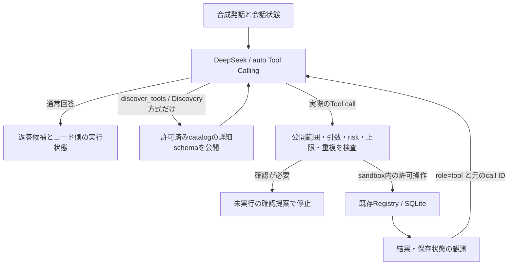

# AI-First Agent Architecture — 調査・比較PoC（#338）

## 判断

PETITの意図・文脈・情報取得・Tool選択・複数工程の判断はDeepSeekを中心とするLLMが担う。Pythonは権限、入力検証、承認、状態、冪等性、実行結果の保証を担う。日本語の言い回しごとに意図判定の正規表現を追加する方向へは進まない。

この文書と `experiments/` は設計・隔離PoCであり、本番 `/api/chat` の実装を切り替えるものではない。調査対象はPR #337の `32e38b7`。同PRのStable ID、Pending、実行結果照合、SQLiteの原子性、再試行、状態保存は維持する。

## コード調査

| 箇所 | 現在の役割と問題 | 方針 |
|---|---|---|
| `agent.run` | Dialogue、Task完了、Project判定がBrainより先に会話を消費する。3ファイルだけを変えても入口全体はAI-Firstにならない。 | 新経路ではDeepSeekが最初の判断をする。旧経路は移行中の比較・互換として隔離する。 |
| `dialogue_resolution._work_operation/_operation` | 発話の形から直接操作を決定する。認識できる表現は高速だが、言い換え・引用・話題転換が表現の列挙に依存する。 | 意図判定はLLMへ移す。`_focus`、stable ID再確認、TTL、原子的なPending消費、実行後照合は実行側で再利用する。 |
| `capability_router.action_requested/_required_capabilities` | キーワードguardがモデルのContext/routeを上書きし、例外時にもWrite capabilityを供給できる。 | 日本語による意図判定を認可と混同しない。LLM失敗時は未実行として対象を保持し、語句から書き込みを推測しない。 |
| `CAPABILITY_GROUPS/validate_capabilities` | 固定グループ・最大4件にTool公開が制限される。新しいToolはRegistryだけに登録してもモデルから届かない。 | ユーザー権限による許可集合と、モデルへ現在公開する集合を分離する。Discoveryで許可集合内の詳細schemaを取得できるようにする。 |
| `brain_runtime._run_context_path` | #337で条件付き継続が入ったが、事前に継続フラグ/Capabilityが必要。取得後に初めて必要と分かる操作は表現しにくい。 | Contextも読み取りToolの結果としてDeepSeekへ返す。同じBrainが追加情報・次の操作・終了を判断する。 |
| `agent_runtime._execute_loop` | Tool結果は元のassistant call/IDを残さず通常のassistant/user文章に変換。`action_requested`や成功文の形による再指示もある。 | 実際の `assistant.tool_calls` と `role=tool/tool_call_id` を往復する。発話の正規表現で実行成功を判定しない。 |
| `lmstudio_client._recovery_messages` | 空出力の再試行ではsystemと直近userだけを残し、Tool結果や取得済み文脈を落とす。 | native Tool履歴を含む場合の回復を別途検証する。Frontend由来の履歴から架空のTool callを作らない。 |
| `tools.registry` | 既に共通schema、handler、risk、検証、dispatch、状態観測hookがある。 | 正本として再利用する。別のAgent/Router/DB/Tool台帳は追加しない。 |
| `sona_core_schedule.PetitGetScheduleAdapter` | 予定の既存Adapter先例。汎用のPETIT MCP clientではない。 | API/MCPのtransport差はhandler/Adapter側へ閉じ込め、同じ実行制御を通す。 |

正規表現の使用自体は禁止しない。ID・日時等の**形式検査**、既存UIの厳密な候補番号、秘密情報のマスキング等はコード側の仕事。ユーザーの一般的な意図・対象・Tool選択を日本語パターンで決定することを中心にしない。

### Registryと公開範囲の実測

現行Registryは61 Tool、全schemaのJSONは25,648文字。固定グループから漏れている名前は14件あるが、すべて公開すべきという意味ではない。

- `execute_agent_write` は内部承認専用で、LLMへ公開してはいけない。
- `add_task` は既存互換の別名として分けて扱う。
- 残る12件はProject候補の発見/検査/紐付け、内部Project作成/別名/切替、完了記録。通常のCapabilityルートからは選べず、別の決定論的経路等に依存する。これは「機能が未実装」という意味ではない。

したがって **61件をそのまま全公開する案は採用しない**。特に、未登録名に対する `risk_for()` の既存既定値はsafe_readであり、外部MCPの自己申告をそのまま登録する設計は安全でない。PoCでは登録済みかつ明示したsandbox集合のToolだけを扱う。

## 3方式の比較

| 観点 | 現行 #337 | DeepSeekの直接Tool Calling | LLMによるTool Discovery |
|---|---|---|---|
| 会話品質 | 厳密な開始は確実。モデルへ届くschemaが狭いと説明や候補検索が不足する。 | Toolの意味と状態を同じBrainが参照できる。翻訳等の一般会話の品質は別途評価が必要。 | 未知のToolを後から取得できるが、発見自体が不要検索を誘発しうる。 |
| 誤操作 | 認識する形はコードで保護できるが、意図判断と安全境界が混ざる。 | 意図判断はLLM。許可/検証/承認/重複防止/保存確認は実行側に必要。 | 発見は権限を増やさない。公開済みでも実行直前の再認可が必要。 |
| Tool選択 | 最大4グループの固定表に依存。 | 小さな許可Tool集合では直接選べる。全61件での精度は未測定。 | グループ外へ拡張できる。Discovery失敗・古いschema・名前衝突の扱いが増える。 |
| 速度/Call | 明確な開始0 Call、雑談1、Context原則2、Agentは入口Callが別。 | 雑談1。単発Toolは通常2、Read→Writeは通常3。既存0 Call操作より遅い。 | 発見が必要な場合はさらに1 Call以上。小さなcatalogでは不利になりうる。 |
| 保守性 | 表現・Router・Tool登録の複数箇所に更新が必要。 | 既存Registryの説明/schemaと実行契約を中心に保守できる。 | catalogのpermission filtering、キャッシュ、版管理、失効処理が必要。 |
| スケール | グループ表が公開のボトルネック。 | 初回schema量がTool数に比例する。 | 初回を要約indexへ縮められるが、要約index自体も無限には増やせない。 |

文字数はtokensではない。PoCで使う7 Toolの全schemaは3,648文字、Discovery indexは1,386文字。全61件のindexを同じ方法で作ると7,755文字だが、**61件での実モデル選択評価は行っていない**。呼出数が減ってもschemaの総送信量や料金が減るとは限らない。

## 最小PoC

`experiments/ai_first_tool_calling.py` は実験専用のループで、APIには接続しない。実行関数を呼出側が明示しなければ動かない。新しい本番Agentを作るものではない。既存Runtimeの固定routingと会話への結果変換を保ったままではnative protocolを比較できないため、隔離したテスト用入口だけを置いた。



- 既存のschema、`parse_arguments`、risk/承認判定、dispatch、`_tool_failed`、結果圧縮、State観測を再利用する。意図判定regexは追加しない。
- 実際のassistant messageとcall IDを保存する。架空のcallを履歴へ挿入しない。thinkingを将来使う場合に備え、返されたreasoning fieldを往復できるが、今回の実モデル測定は既存clientのnon-thinkingで行う。
- DiscoveryのTool名はLLMが説明から選び、Pythonは存在/公開範囲/件数だけ検査する。再発見で公開集合を拡張できる。自然言語queryの固定キーワード検索は置かない。
- 実行回数・重複signatureを制限し、未公開/未登録Toolは実行しない。承認対象は提案として止める。既存の本番approval/resume APIには接続しない。
- `execution_status=tool_reported_success` は**Toolの成功返却**を意味する。一般の永続状態検証を意味しない。作業開始は評価用executorと最終DBアサーションで保存状態も別途検証する。

### 保証の限界

Toolを実行せずモデルが自然文だけで「開始した」と答えた場合、コードは `not_executed` と判定する。しかし、任意の自然文の意味までは検証できないため、その返答候補自体はまだ残る。この反例をテストに含める。**実行状態が正しいことと、自由文が常に正しいことは別**であり、本番にそのまま接続できない理由の1つ。

本番移行には、#303のTurn/Action結果契約を使い、操作の成功/失敗/部分成功/確認待ちの報告をreceiptと保存状態から構成する必要がある。自由文を成功判定に使わない。モデルに「意図」を構造化させても、それ自体は意味の正しさの証明にはならない。

## 実モデル評価

モデルは既存設定のDeepSeek Flash、thinking無効、temperature指定0。3方式とも同じprovider/modelを使う。実行Toolは7件に限定し、DBはケースごとにTemporaryDirectoryへ作成。予定Readは合成fixture、Notionは無効。既存アプリ、個人DB、BRAIN、私的会話、画像を評価データとして送信しない。envファイルから読むのはDeepSeek接続に必要な限定キーだけ。設定ファイルを書き換えない。

12ケースは、明示開始、短い開始、再開/記録の言い換え、状態質問、引用の翻訳、仮定、否定、雑談、曖昧対象、Read→Action、予定の承認待ち。生の合成入力・出力・観測値は `reports/ai-first-evaluation.json`、集計は `reports/ai-first-evaluation-summary.json`。自動のbehavior条件はDB上の実行/停止だけで、会話品質の合格点と混同しない。

初回pilotでは固定の会話時刻と保存時刻が一致しなかったため、時刻をそろえた再測定を正式結果とする。pilotは `reports/ai-first-pilot-evaluation.json` として区別する。

### 正式結果（実DeepSeek、12ケース×3方式、各1回）

| 指標 | 現行 #337 | 直接 | Discovery |
|---|---:|---:|---:|
| 自動の実行/停止条件 | 11/12 | 12/12 | 12/12 |
| 期待Task IDで開始（5ケース） | 4/5 | 5/5 | 5/5 |
| 質問/引用/仮定/否定/雑談の誤Write試行 | 0/5 | 0/5 | 0/5 |
| 曖昧対象で両候補を提示 | 0/1 | 1/1 | 1/1 |
| 承認対象を未実行で停止 | 1/1 | 1/1 | 1/1 |
| LLM Call合計 | 26 | 23 | 30 |
| p50（ms） | 2,761.5 | 2,182.5 | 3,177.5 |
| p95（ms、12標本の上位） | 6,840 | 4,272 | 4,985 |
| 雑談のCall数 | 1 | 1 | 1 |
| schema JSON総送信文字数 | 89,065 | 83,904 | 60,176 |

現行のRead→ActionケースはRead後に操作へ到達せず終了した。直接/Discoveryは `get_tasks → start_work_session` で正しいTask IDを保存した。曖昧ケースでは直接/Discoveryが2候補を出したが、現行は最終的にIDを指定するよう求め、候補を返答へ出せなかった。

ただし、**直接方式は引用内の文の英訳に失敗**し、引用内ではなくユーザーの依頼文を英訳した。自動の12/12はこの品質不良を検出しない。仮定質問は全方式でWriteなしだが、直接/Discoveryでも不要なReadや開始提案が残る。pilotのDiscoveryは雑談で予定・タスクを読み、3 Callとなった（正式測定では1 Call）。temperature指定0でも結果は固定されない。

自然文を目視確認した範囲で、正式測定の未実行/失敗/承認待ちを成功とした発話は0件。ただし、この36出力だけから誤成功率0%を保証しない。コード上には「自然文だけの成功claimを完全検証できない」反例も残る。実行条件、自然文品質、追加質問は別々に評価する。

**次の候補は小さなTool集合の直接方式。Discoveryの既定導入と本番移行は見送る。** 直接方式にはCall数・Read→Action接続・候補提示の改善が見られるが、一般会話品質、再試行/Pending継続、未調整ケースでの再現性は移行条件を満たしていない。

この比較には7 Toolのfixture範囲、provider/network/cache、実行順、prompt差の影響がある。現在の0 Call開始を直接方式が速度で上回るわけではない。全61 Tool、実API/MCP、一般的な複数領域の依頼に対する選択精度や料金は未測定。承認UI経由の適用/再開もPoCでは未接続。

再実行（実APIを利用する明示的な実験コマンド）:

```powershell
python -m unittest tests.test_ai_first_poc -v
python -m experiments.evaluate_ai_first --env-file <既存.envのパス> --output reports/ai-first-evaluation.json
```

新規19件のプロトコル/安全テストと、#337のDialogue・State・承認・Work関連を合わせて **107 passed + 11 subtests**。これらのMockは意味理解の精度証明ではなく、native call/result、公開制御、引数、承認前停止、重複、失敗/部分成功、秘密設定の取込範囲を検証する。実モデルの自然文は別に目視確認した。既存#336の失敗5件は今回の対象ではなく、解決済みとはしない。

### 移行判定

小規模比較だけで全面移行しない。自然文の品質、不要な質問/Read、Tool数増加時の選択、故障後の再試行、TTL/話題転換、同時実行、承認後の継続を別の未調整ケースでも反復検証する。引用・仮定・否定の誤Writeは1件でも移行を止める。雑談1 Callを保ち、p50/p95・総入力tokens・成功率の差を確認する。今回のschema文字数をtokensや料金へ換算しない。

## 段階移行案

1. 既存 `_execute_loop` に初回の実Tool responseを引き継ぐ最小変更を検討する。新Agentは作らず、native call/resultの往復、既存Pending/承認再開、receipt/保存結果の報告を先に統合する。本番有効化は後段。
2. Brainの最初のCallへ小さな許可Tool集合を直接公開し、雑談はそのCallで回答。Pythonが発話からToolを選ぶ分岐を増やさない。旧方式との選択は設定で行い、発話内容のregexで振り分けない。
3. Tool数/実測input負荷が必要性を示す場合だけDiscoveryを追加する。既存Capabilityは整理用metadataとして再利用できるが、Intentの固定判定やアクセス権の代用にしない。
4. 未調整ケースで受入後、旧Dialogue/Task/Projectの自然言語判定を段階的に退役させる。ID解決・Pending・冪等性・監査の責務は残す。

## API / MCP / 内部Tool

共通Registryを正本とし、内部Python handler、API handler、MCP Adapterを同じ検証/権限/承認/結果処理へ接続する。いま汎用MCP clientや新しいAdapter抽象を実装する必要はない。

将来のMCP登録は、名前衝突を避けるprovider namespace、許可された接続先、schema、ローカルで決めたrisk、実行に必要なscope、timeout、idempotency、結果検証を既存Tool定義へ段階的に足す。モデルへ公開する前と実行直前にpermissionを検査する。外部のdescription/annotationsで権限を与えない。

MCP `tools/list` はpaginationを持ち、`listChanged` はcatalog更新の通知に使える。これはモデルの意味検索そのものではない。詳細schemaをローカルにキャッシュし、更新/失効を反映する方式を検討する。実MCP接続・OAuth・サーバー側の重複防止は今回未検証。

## 公式仕様の確認（2026-10-19）

- DeepSeekのTool Calling例は実assistant callを保存し、`tool_call_id` に対応したTool結果を返す。thinking利用時はreasoning fieldの継続が必要。[Tool Calls](https://api-docs.deepseek.com/guides/tool_calls/)、[Thinking Mode](https://api-docs.deepseek.com/guides/thinking_mode/)
- strict modeはBetaでschema上の制約もある。引数形式の保証であり、ユーザーの意図・権限・保存成功を保証しない。今回betaへの切替やschema全面変換は行わない。[Tool Calls](https://api-docs.deepseek.com/guides/tool_calls/)
- MCPのTool列挙・更新通知と、外部annotationsの信頼境界を参照。今回使った版の仕様であり、PETIT側への実装済み機能ではない。[MCP Tools仕様](https://modelcontextprotocol.io/specification/2025-11-25/server/tools)
