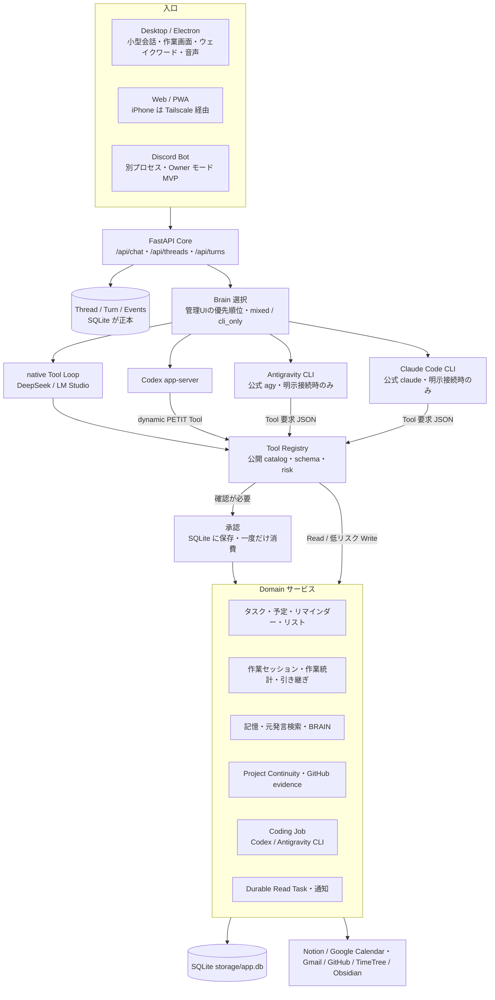

# PETIT Architecture — 現行の実装概要

> Status: **現行（実装済みの概要）** / Last updated: **2026-11-06**（v0.45.0 開発版）
>
> PETITがいまどう動いているかを1枚で把握するための入口。
> 目指す姿は [Concept.md](../Concept.md)、会話処理・Tool実行の詳細フローの正本は [runtime-flows.md](runtime-flows.md) を見る。
> 本書と runtime-flows.md が食い違う場合は runtime-flows.md を正とし、本書を直す。

---

## 1. 全体像



---

## 2. 層ごとの説明

### 2.1 入口（Channels）

| 入口 | 実装 | 詳細 |
| --- | --- | --- |
| Web / PWA | `frontend/`（HTML / CSS / Vanilla JS）を FastAPI から配信。Chat / Univ / Develop / Dashboard の4画面 | [ui/ui-chat-first-dashboard.md](ui/ui-chat-first-dashboard.md)、[channels/iphone_phase0_tailscale.md](channels/iphone_phase0_tailscale.md) |
| Desktop | `desktop/`（Electron）。既存のCoreへ接続するクライアントで、Core は同梱しない。ウェイクワードは openWakeWord（`wake/`） | [desktop/desktop.md](desktop/desktop.md)、[voice/openwakeword.md](voice/openwakeword.md) |
| 音声 | Desktop の音声会話、Web 録音、AivisSpeech 読み上げ | [voice/voice_mode.md](voice/voice_mode.md)、[voice/aivis_speech.md](voice/aivis_speech.md) |
| iOS | `ios/PETITMobile` は試作段階 | [../ios/PETITMobile/PHASE_STATUS.md](../ios/PETITMobile/PHASE_STATUS.md) |
| Discord | **Owner モード MVP（v0.46.0）**。別プロセスの Bot（`backend/channels/discord/`）が DM・指定サーバーのメンションを `/api/channels/discord/events` へ中継し、owner 判定は Core が行う。owner 以外は固定の案内だけで Brain を呼ばない。承認ボタン（owner のみ・Discord 由来の承認のみ）と通知の DM 配送（opt-in）あり。Guild モードは未実装 | [channels/discord-bot.md](channels/discord-bot.md) |

### 2.2 会話の台帳（Thread / Turn）

- 会話はThreadごとに独立し、Turn（1回のやり取り）は受け付けた時点でSQLiteに保存する。同じ request ID で再送されたら、保存済みの結果を返す。
- 他のThreadの履歴は通常の文脈に入れない。横断検索は専用のToolで明示的に取得する。
- 詳細: [core/renaissance-core.md](core/renaissance-core.md)、[core/conversation-state.md](core/conversation-state.md)

### 2.3 Brain（会話の担当AI）

- **1回のTurnを、優先順位で選んだ1つのBrainが最後まで担当する。** 順位は管理UIで設定する（[ops/setup-integrations.md](ops/setup-integrations.md)）。
- 対応するBrain:
  - **DeepSeek / LM Studio**: PETIT内部の native Tool Loop で動く（8 rounds / 12 calls で停止）。
  - **Codex CLI**: app-server の Agent Loop。PETIT の Tool は dynamic Tool として渡す。Codex の shell / apps / plugins / subagent は無効にしている。
    - **エージェントモード（v0.47.0、設定で ON のときだけ）**: 作業場所を PETIT Home にし、ファイル操作・開発は Core の Home ファイル Tool と worktree Tool で行う。Codex 自身の sandbox は read-only・shell なしのまま。詳細は [brain/agent-home.md](brain/agent-home.md) §4.5。
  - **Antigravity CLI**: 公式 `agy` を本人のCLI認証で起動する。設定画面で明示的に接続したときだけ使える。規約上の許諾は未確定（[brain/antigravity-cli.md](brain/antigravity-cli.md)）。
  - **Claude Code CLI**: 公式 `claude` をヘッドレスで起動し、組込みTool・MCP・設定読込を無効にしてJSONで判断だけを受け取る。明示接続時のみ（[brain/claude-code-cli.md](brain/claude-code-cli.md)）。
    - **エージェントモード（v0.46.0、設定で ON のときだけ）**: PETIT Home を作業場所に、組込みファイル Tool と PETIT Tool（MCP）を使い、PreToolUse Hook で L0〜L3 の線を引く。人格ファイルは差分承認。詳細は [brain/agent-home.md](brain/agent-home.md) §4.3。
- 既定の優先順位は Concept §4 と同じ Antigravity CLI → Codex → Claude Code → DeepSeek。未接続の候補は飛ばす。保存済みの順位は書き換えず、新しく接続したCLIは方針順の位置へ挿入する（Antigravity CLIの「先頭へ」ボタンは従来どおり）。
- **Front Brain（v0.50.0、設定のトグルで ON のときだけ）**: Turn の順位だけ DeepSeek を先頭にする（保存済みの順位は変えない）。複数ステップの作業は `delegate_to_agent` で作業用 Thread の Turn としてエージェントモードの CLI に任せ、結果は Core が元の Thread へ報告する。詳細は [brain/front-brain-delegation.md](brain/front-brain-delegation.md)。
- `brain_transport=cli_only` にすると、CLI（Codex / Antigravity CLI / Claude Code CLI）だけを使い、APIへは切り替えない。
- 障害時は、Toolを実行する前に限って次の候補へ切り替える。Tool実行後に障害が起きたら、そのTurnは失敗として扱う。
- Antigravity SDK は撤去済み（[brain/sdk-retirement.md](brain/sdk-retirement.md)）。
- キーワードで先に処理する旧ルーター（agent / capability_router / brain_runtime / context_broker / dialogue_resolution / project_router など）は v0.45.0 で撤去した。画像付き会話は `vision_reply.py` のRead専用1 Callへ移した（[archive/runtime-flows-legacy-routing.md](archive/runtime-flows-legacy-routing.md)）。
- 詳細: [runtime-flows.md](runtime-flows.md) の「v0.34.0: 初期設定・優先順位と単一Brain」、[brain/persistent-agent-workspace.md](brain/persistent-agent-workspace.md)

### 2.4 Tool・承認・実行記録

- Tool は `backend/tools/registry.py` に登録すると、Brain から呼べるようになる。どのBrainから呼ばれても、同じ schema・risk・承認を通る。
- 書き込みは確認カードで承認を取り、承認は一度だけ消費する。SQLiteへの書き込みは Domain の保存と実行記録（effect receipt）を同じ transaction で確定する。
- 外部への書き込みは exactly-once を主張しない。途中で止まったものは unknown とし、自動では再実行しない。
- 詳細: [runtime-flows.md](runtime-flows.md) の §3〜§5、§10

### 2.5 Domain（機能）

| 領域 | 主な中身 | 詳細 |
| --- | --- | --- |
| 生活・タスク | ローカルタスク（SQLite）、Notion 双方向同期、リスト、リマインダー、予定（ローカル / Google Calendar 読み取り / TimeTree 取り込み） | [life/](life/) |
| 作業記録 | 作業セッション、作業統計、Dashboard の90日集計、引き継ぎメモ | [life/work-statistics.md](life/work-statistics.md) |
| 記憶 | 記憶の保存と訂正、元発言の検索、Obsidian BRAIN 検索、Chroma（置き換え可能な検索インデックス） | [core/renaissance-memory.md](core/renaissance-memory.md)、[core/assistant-architecture.md](core/assistant-architecture.md) |
| プロジェクト | Project Continuity（開始・再開・完了の確認）、GitHub evidence、ローカル開発環境の観測 | [core/assistant-architecture.md](core/assistant-architecture.md)、[dev/](dev/) |
| 開発の委譲 | Coding Job: 許可したGitルートを専用のcloneにコピーし、Codex / Antigravity CLI / Claude Code CLI が Core の限定Tool（list / read / write / 静的check）で作業する。実テスト・Push・PRは未対応 | [dev/coding-tasks.md](dev/coding-tasks.md) |
| バックグラウンド | Durable Read Task（ニュース・天気）、通知イベント、Web Push | [core/durable-read-tasks.md](core/durable-read-tasks.md)、[channels/web_push_notifications.md](channels/web_push_notifications.md) |

### 2.6 データの正本

| データ | 正本 |
| --- | --- |
| 会話・Turn・承認・実行記録・タスクのミラー・作業記録 | SQLite（`storage/app.db`、Git 管理外） |
| 編集できるタスク・プロジェクト | Notion（SQLite はミラーと送信キュー） |
| 個人の知識・決定 | Obsidian BRAIN（Markdown） |
| 予定 | Google Calendar（読み取りのみ）。PETIT からの書き込みはローカル予定だけ |
| 開発の証拠 | GitHub（読み取りのみ） |
| 意味検索 | Chroma（正本ではなく、作り直せるインデックス） |

### 2.7 設定と認証

- 秘密値は環境変数、または Git 管理外の暗号化設定に置く。Web API や HTML には返さない。
- 管理者ログインは1つ（scrypt + HttpOnly cookie + Origin 検査）。非管理者は Tool を使わない通常会話モードになる。
- **アカウントという概念はまだない。** 設定はホストごと。

---

## 3. ディレクトリ構成

```text
PETIT/
  backend/        FastAPI Core（main.py / app.py）、Brain、Tool Registry（tools/）、Domain サービス
  frontend/       Web / PWA の画面（Vanilla JS）
  desktop/        Electron の Desktop クライアント
  wake/           ウェイクワードのモデルと学習資材
  ios/            iOS ネイティブ版の試作
  tools/          バックエンド外の単体ツール（TimeTree バックアップなど）
  scripts/        セットアップ・スモークテスト・運用スクリプト
  tests/          Python / Node のテスト
  reports/        実機・合成データでの検証結果
  storage/        実行時データ（Git 管理外）
  docs/           設計・仕様（配置は docs/README.md）
  Concept.md      目標（北極星）
  AGENTS.md       開発ルールの正本
  PROGRESS.md     現在地と変更履歴
```

---

## 4. 目標（Concept.md）との差

| 目標 | 現状 | 次の一手 |
| --- | --- | --- |
| Router（DeepSeek）と Executor（CLI）の分離 | 既定は1つのBrainがTurnを最後まで担当。トグル ON で DeepSeek が最初の担当になり、CLI へ委譲できる（v0.50.0） | 実 CLI での通し確認と振り分け精度の評価（[設計](brain/front-brain-delegation.md) §7） |
| Executor の優先順位 Antigravity ＞ Codex ＞ Claude Code ＞ DeepSeek | 既定値を方針順に設定済み（v0.44.0）。保存済みの順位は変えない | 実端末で各CLIの接続テスト |
| Claude Code CLI 対応 | 会話Brain・Coding Jobに実装（v0.44.0）。契約上の扱いは未確認 | 実ログイン環境での受入、得意分野による振り分け（§10） |
| アカウント型の設定共通化 | ホスト別の設定と管理者1名 | アカウントのモデルと保存先を設計する |
| Discord 常駐Bot | Owner モード（会話・承認ボタン・通知、v0.46.0） | Guild モード（D3〜）、実 Discord での受入 |
| ファイルの検索と添付 | 未実装 | Everything / ローカル / Drive の読み取り境界と送信の確認を設計する |
| 開発の司令塔 | Coding Job は静的checkまで | 実テスト実行・Push・PR を、承認つきで段階的に開放する |
| Desktop を主入口に | Electron クライアント。Core の自動起動・同梱はない | [desktop/desktop-foundation-design.md](desktop/desktop-foundation-design.md) の段階導入 |
