# PETIT Runtime Flows — 旧キーワードルーティング（アーカイブ）

> Status: **アーカイブ** / 2026-11-06（v0.45.0）で実装を撤去。後継: [../runtime-flows.md](../runtime-flows.md)、[../architecture.md](../architecture.md)
>
> v0.30系までの「決定論的ルート → Capability Router → Context Broker → Deep Agent」の会話経路。
> #345で本番text経路から外れた後も画像付き会話だけが使っていたが、v0.45.0で画像を `vision_reply.py` へ移し、
> `agent.py` / `agent_legacy.py` / `agent_runtime.py` / `brain_runtime.py` / `capability_router.py` / `context_broker.py` / `model_router.py` /
> `dialogue_resolution.py` / `project_router.py` / `project_resume.py` / `project_source_refresh.py` / `task_completion*.py` / `task_work_intent.py` /
> `task_conversation.py` / `list_conversation.py` / `date_parser.py` / `recall.py` / `agent_state.py` / `agent_progress.py` / `tools/agent_actions.py` を削除した。
> 以下の図は削除前の記録で、現行の実装ではない。コードはGit履歴で参照できる。

実装の根拠:

- `backend/main.py`
- `backend/chat.py`
- `backend/chat_models.py`
- `backend/pending_actions.py`
- `backend/agent.py`
- `backend/brain_runtime.py`
- `backend/context_broker.py`
- `backend/workspace_context.py`
- `backend/petit_prompt.py`
- `backend/agent_runtime.py`
- `backend/capability_router.py`
- `backend/situation.py`
- `backend/time_context.py`
- `backend/work_sessions.py`
- `backend/tools/work_sessions.py`
- `backend/task_work_intent.py`
- `backend/tools/registry.py`
- `backend/agent_state.py`
- `backend/agent_progress.py`
- `backend/project_router.py`
- `backend/task_completion_intent.py`
- `backend/dialogue_state.py`
- `backend/dialogue_resolution.py`

---

## 1. 会話全体フロー

### 画像添付のRead専用経路（v0.31.0 / #333）

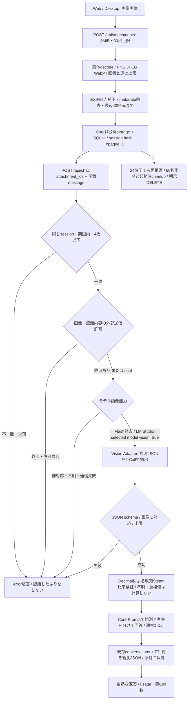

画像経路は `agent.run` / Capability選択 / Tool Loopへ入らず、画像内の命令からWrite・承認を生成しない。外部送信は `PETIT_ALLOW_CLOUD_IMAGES` が既定OFF。VisionのProviderは既存DeepSeek Flashを優先し、`PETIT_VISION_PROFILE=local` の場合はLM Studio `/api/v1/models` の選択モデル `capabilities.vision=true` が必要。未確認モデルは失敗にする。観測の回答生成先が外部の場合も同意を再検査する。通常2 Call、空出力再試行は最大各1回。HTTP timeoutは画像経路で各45秒。画像経路のMarkdown/Chroma自動exportは停止し、認識JSONは24時間で削除する。既存会話の返答/添付IDは既存履歴の保持方針に従う。

画像とProject/GitHubの自動照合、Discord、新Thread/Turn APIはこの経路に未接続。後続は [計画](../channels/multimodal-discord-plan.md) と #245/#246/#303/#304を参照する。session IDは既存ローカルClientの会話境界であり、インターネット公開用のユーザー認証ではない。

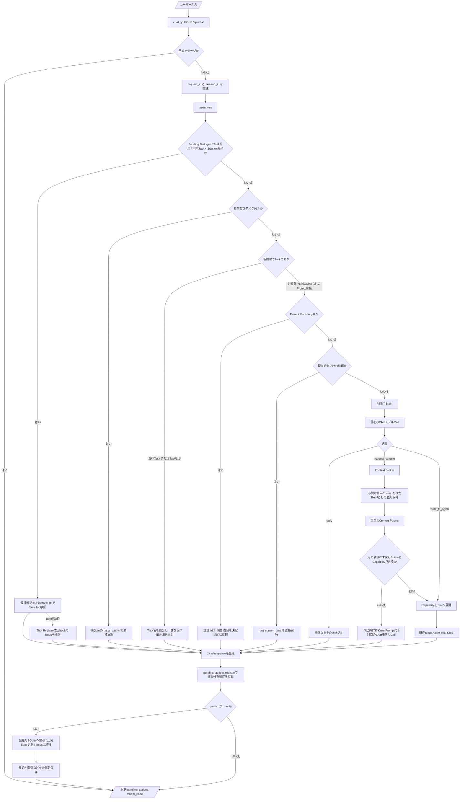

`backend/chat.py` が `/api/chat`、Agent実行、observability、Pending Action登録、SQLite会話保存、Chroma/Markdown artifact保存を所有します。`backend/main.py` はChat Routerを登録するだけで、会話実装の詳細を持ちません。

PETITの人格と会話原則は `petit_prompt.py` のCore Promptを正とします。Tool不要の雑談・相談・説明・文章作成は最初の1 LLM Callで終了します。Broker対応sourceのReadだけ不足する会話は `Brain -> Context Broker -> Brain` の原則2 Callで完了し、書き込みや対象外・複雑処理は既存Deep Agentへ進みます。

---

## 2. PETIT Brain / Context Broker

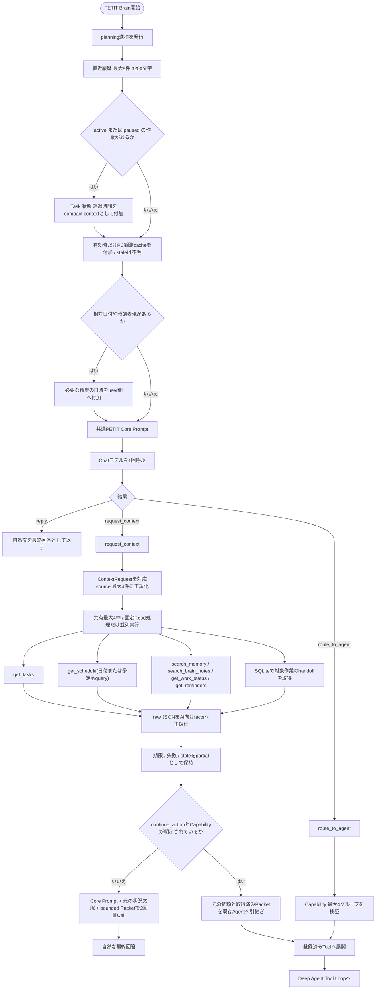

日時はsystem promptへ毎ターン結合せず、相対日付・相対時刻があるターンだけuser側へ注入します。active / pausedのWork Sessionがある場合だけ、小さいuser contextをConversation Entryへ付加します。

Context Brokerは `tasks` / `calendar` / `memory` / `brain` / `work` / `reminders` / `handoff` に対応します。 Calendar Readは日付またはキーワード`query`を`get_schedule`へ渡し、両方未指定なら`date_or_query_required`を返します。TimeTree等のSQLiteキャッシュの題名・説明・場所を検索し、日付未指定の検索では未来を優先します。Brokerは具体Tool名をLLMへ大量公開せず、固定したRead処理へ変換し、Toolのriskも実行直前に検証します。独立sourceは最大4件を並列取得し、各source約2500文字のfacts、記録時刻、鮮度、切詰めの有無を返します。詳細なsource対応表は [jarvis-agent.md](../core/jarvis-agent.md) を参照。

`PETIT_CONTEXT_BROKER_TIMEOUT_SECONDS`（既定10秒）を超えたReadを待ち続けず、取得済みの部分結果を返します。実行中のproviderは強制停止できないため終了まで共有枠を占有し、新規要求は枠がなければ`source_busy`。実行待ちのキューを無制限に積みません。不正応答、providerエラー、staleを0件の成功として扱いません。2回目Callにも入口のactive work等を引き継ぎます。

### Call数の基準

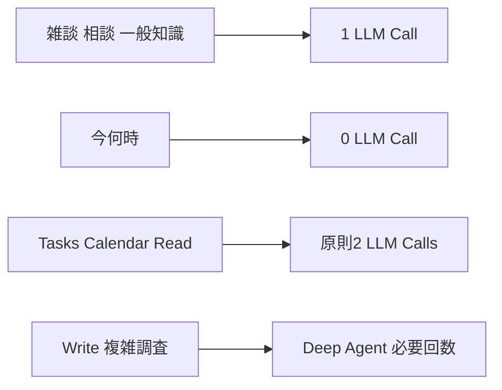

### Capabilityと公開Tool

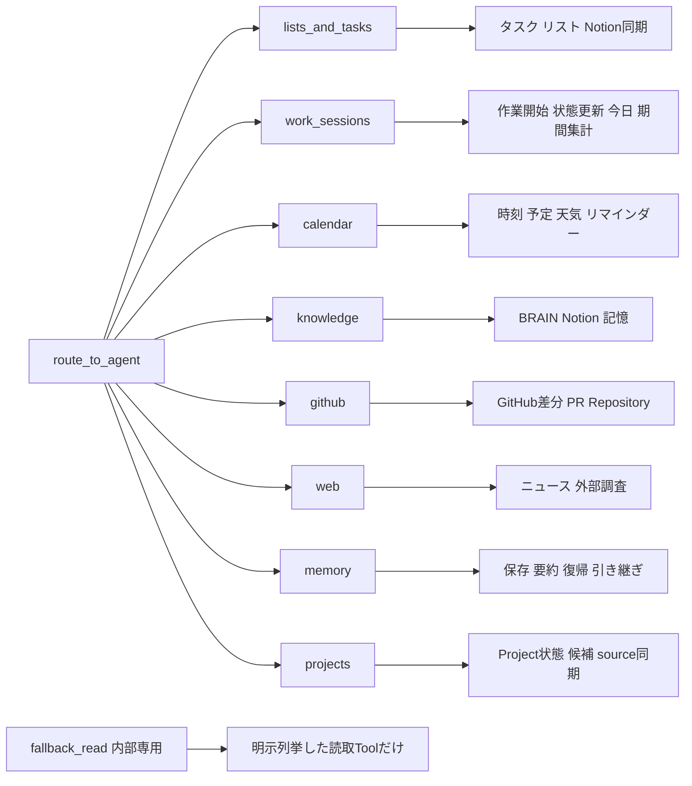

`fallback_read`はSelectorへ公開しない内部グループです。Context Broker対象外の安全なfallbackまたはDeep Agentでだけ使用し、書き込みToolを含めません。

### 作業記録

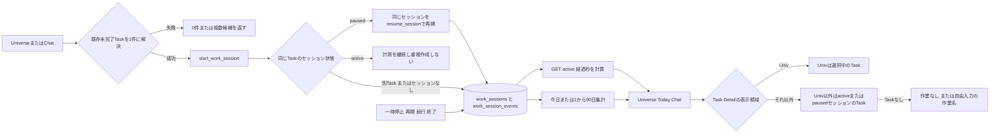

Notion Task DBへ作業時間プロパティは追加しません。SQLiteのセッションへPETIT内部`task_id`を保存し、Notionを含むタスク正本と参照で結びます。開始・一時停止・再開・終了はイベントとして残すため、日付をまたぐ休憩も暦日単位で集計できます。`start_work_session`と`update_work_session`は明示依頼時の低リスク書き込み、`get_work_status`と`get_work_report`は読み取りです。

「HERE再開」「HEREタスク再開」「HERE作業再開」はProject判定より前にSQLiteの既存未完了Taskを照合します。入力どおりの完全一致、末尾の「タスク／作業」を除いた完全一致、一意な部分一致の順で解決し、複数候補では書き込みません。Task明示で0件ならTaskが見つからない旨を返し、Project登録へ流しません。Projectを明示した入力は従来経路を維持し、同名TaskとProjectがある省略入力は選択を求めます。終了済みの作業は保持して新しい計測を開始し、Taskの状態自体は変更しません。

---

## 3. Agent Tool Loop

```mermaid
flowchart TD
    call[Agentモデルを呼ぶ]
    hasCalls{Tool callがあるか}

    answer[回答本文を取得]
    empty{回答が空か}
    fallbackAnswer[言い換えを求める固定文]
    incomplete{作業予告・重複確認またはActionにWrite実行結果がないか}
    retryUsed{再実行済みか}
    forceTool[このターンでTool callするよう再指示]
    deferredFail[未実行を明示した失敗回答]
    finalizing[finalizing進捗を発行]
    final[/最終回答/]

    roundLimit{Toolラウンド上限か}
    stopRound[tool_iteration_limitで停止]
    normalize[Tool callsを正規化]
    each[各Tool callを処理]
    totalLimit{Tool総数6回に到達か}
    stopTotal[tool_call_limitで停止]
    allowed{公開済みToolか}
    notAllowed[tool_not_allowed結果]
    args{引数検証に成功したか}
    badArgs[invalid_tool_arguments結果]
    duplicate{同じToolと引数を実行済みか}
    duplicateStop[duplicate_tool_call結果]
    confirmation{Tool riskが確認対象か}
    writeFlow[確認付き書き込みフロー]
    execute[Toolをdispatch]
    progressStart[tool_started進捗]
    progressFinish[tool_finished進捗]
    compact[結果を最大20項目 5000文字へ圧縮]
    append[元の依頼とTool結果をmessagesへ追加]

    call --> hasCalls
    hasCalls -->|いいえ| answer --> empty
    empty -->|はい| fallbackAnswer --> incomplete
    empty -->|いいえ| incomplete
    incomplete -->|いいえ| evidence[実行結果を優先 / 失敗・部分成功を固定文で報告] --> finalizing --> final
    incomplete -->|はい| retryUsed
    retryUsed -->|いいえ| forceTool --> call
    retryUsed -->|はい| deferredFail --> finalizing

    hasCalls -->|はい| roundLimit
    roundLimit -->|はい| stopRound --> final
    roundLimit -->|いいえ| normalize --> each --> totalLimit
    totalLimit -->|はい| stopTotal --> final
    totalLimit -->|いいえ| allowed
    allowed -->|いいえ| notAllowed --> compact
    allowed -->|はい| args
    args -->|いいえ| badArgs --> compact
    args -->|はい| duplicate
    duplicate -->|はい| duplicateStop --> compact
    duplicate -->|いいえ| confirmation
    confirmation -->|はい| writeFlow
    confirmation -->|いいえ| progressStart --> execute --> progressFinish --> compact
    compact --> append --> call
```

親子関係の変更は`set_task_parent`へ集約します。タスク名変更も同時に必要な場合は、同じTool callの`title`へ含めます。作成・変更・完了・親子変更・同期再試行は、ユーザーの明示指示がある場合に限ってAgentがToolをcallし、`low_risk_write`として同じターン内で実行します。対象が曖昧な場合はToolをcallせず、候補を絞る質問を返します。

Agentの出力もPETIT Core Promptを共有し、Toolあり/なしで人格を切り替えません。

---

## 4. Tool Registryとリスク判定

```mermaid
flowchart TD
    decorator[@tool decorator]
    riskInput{riskが明示されているか}
    explicit[指定riskを使用]
    override{既定risk一覧にあるか}
    defaultRisk[既定riskを使用]
    legacy{requires_confirmationがtrueか}
    confirm[confirm_write]
    safe[safe_read]
    register[Registryへ登録]

    invoke[AgentがToolを選択]
    parse[引数JSONをdictへ]
    writeRisk{confirm_write または destructiveか}
    schema[properties required type enumを検証]
    valid{schemaに適合するか}
    invalid[[error]またはinvalid_tool_arguments]
    dispatch[handlerを実行]
    error{例外や実行時エラーか}
    errorText[[error]文字列]
    result[JSONまたは文字列]
    observe[Task成功 / Workの対象IDと実行状態をfocusとlast_actionへ / best effort]

    decorator --> riskInput
    riskInput -->|はい| explicit --> register
    riskInput -->|いいえ| override
    override -->|はい| defaultRisk --> register
    override -->|いいえ| legacy
    legacy -->|はい| confirm --> register
    legacy -->|いいえ| safe --> register

    invoke --> parse --> writeRisk
    writeRisk -->|はい| schema --> valid
    valid -->|いいえ| invalid
    valid -->|はい| dispatch
    writeRisk -->|いいえ| dispatch
    dispatch --> error
    error -->|はい| errorText
    error -->|いいえ| observe --> result
```

### リスク区分

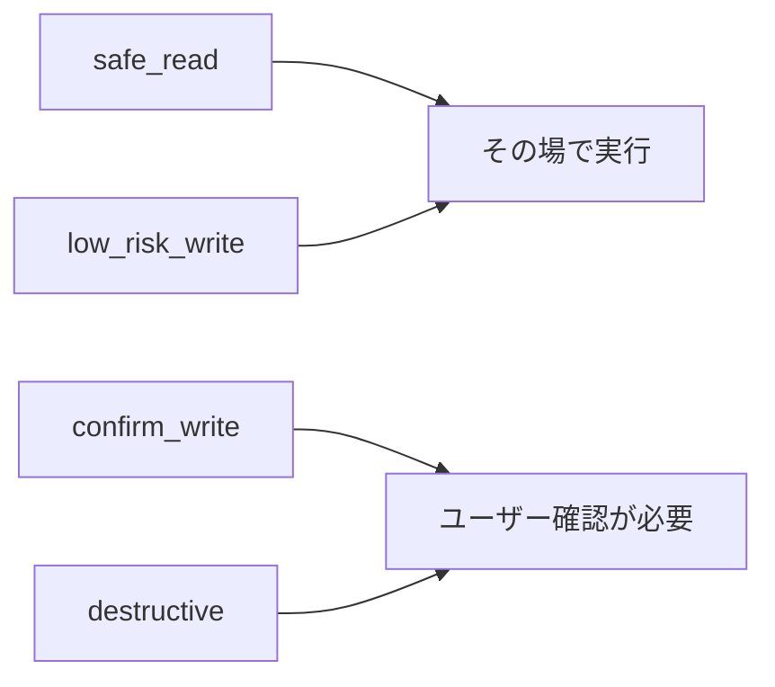

タスク操作では`create_task`、`update_task`、`complete_task`、`set_task_parent`、`retry_task_sync`を可逆な`low_risk_write`として扱います。予定追加、BRAIN本文編集、外部ソースとの紐付けなど影響範囲が広い操作は`confirm_write`を維持し、削除などの`destructive`は常に確認対象です。riskにかかわらず、書き込みToolの引数はschemaで検証してから実行します。

---

## 5. 確認付き書き込みと再開

```mermaid
flowchart TD
    proposal[Agentが確認対象Toolを提案]
    args[Tool schema検証済みの引数]
    saveState[Agent stateをSQLiteへ保存]
    confirmation[Runtimeが確認文とexecute_agent_writeを1回だけ返す]
    register[pending_actions.pyがapproval_idを登録 10分TTL]
    api[POST /api/actions/{approval_id}]
    decision{ユーザーが承認したか}
    cancel[書き込みをキャンセル]
    wrapper[execute_agent_write]
    load{Agent stateが30分以内か}
    expired[期限切れエラー]
    validate{対象Toolが確認対象か}
    invalid[許可されていないTool]
    started[tool_started進捗]
    dispatch[元のsessionを束縛して対象Toolをdispatch / 成功hook]
    failed{書き込み成功か}
    failure[tool_finished失敗]
    resume[resume_after_write]
    readOnly[確認不要Toolだけを公開してAgent Loop再開]
    final[自然な最終回答]
    delete[Agent stateを削除]

    proposal --> args --> saveState --> confirmation --> register --> api --> decision
    decision -->|いいえ| cancel
    decision -->|はい| wrapper --> load
    load -->|いいえ| expired
    load -->|はい| validate
    validate -->|いいえ| invalid
    validate -->|はい| started --> dispatch --> failed
    failed -->|いいえ| failure
    failed -->|はい| resume --> readOnly --> final --> delete
```

`pending_actions.py` が短期のapproval状態、10分TTL、承認API、承認後のTool dispatchを所有します。`chat.py` はAgent Runtimeが返した`pending_actions`を`pending_actions.register(...)`へ渡し、返された`approval_id`を`ChatResponse`へ載せるだけです。APIモデルは`chat_models.py`で共有し、確認Routerから`main.py`を参照しません。

Agentが自然文だけで「実行しますか？」と返した場合は承認として扱わず、確認対象Toolをcallするよう1回だけ再指示します。

---

## 6. 進捗表示

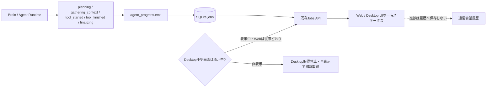

---

## 7. 名前付きタスク完了の決定論的フロー

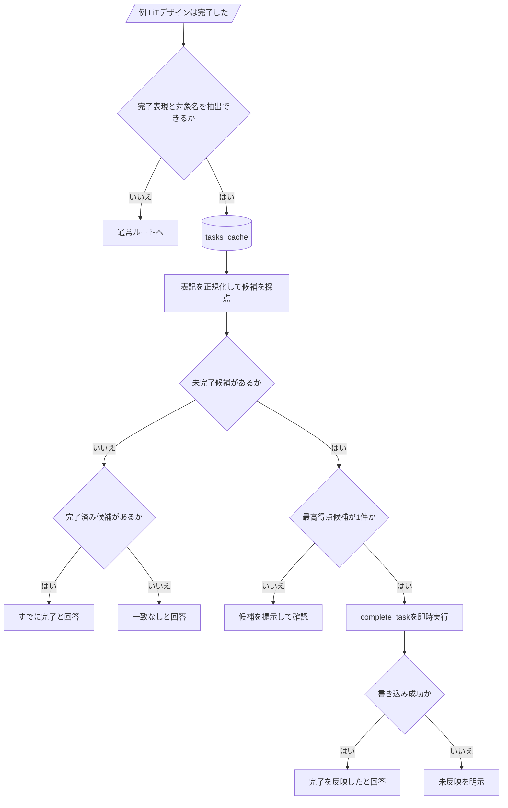

---

## 8. Project Continuityの決定論的フロー

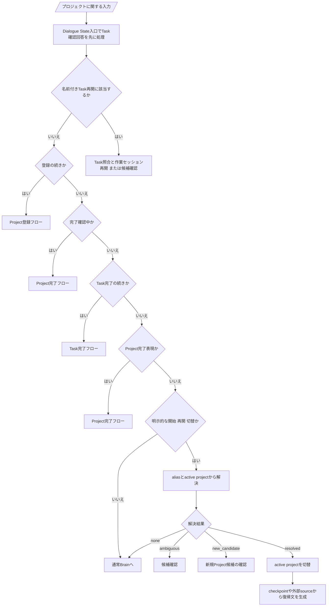

---

## 9. チャットで行えることの全体像

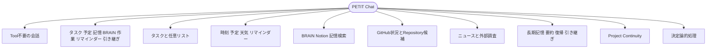

---

## 10. 停止条件と安全境界

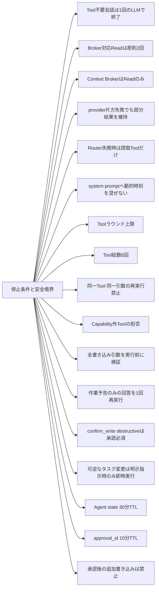

---

## Dialogue Stateと確認回答 (#294)

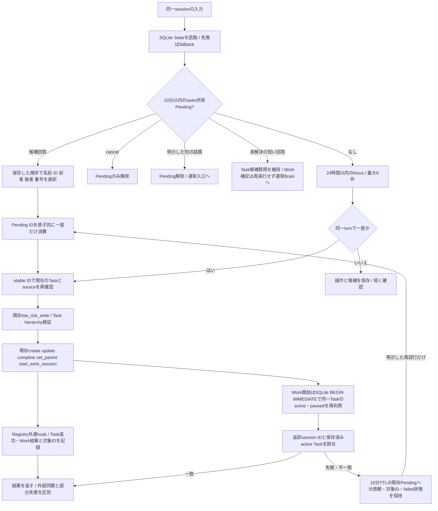

Task clarificationはaction approvalではありません。確認付きwriteは既存確認APIのままです。大量一覧ReadやTask失敗結果はfocusを上書きしません。Work開始失敗は再試行対象としてIDを保持しますが、成功した作業状態とは区別します。Frontend `history`は互換維持し、Dialogueの正本はsession別Backend SQLiteです。明示的な話題転換・キャンセル後は短い開始だけで旧対象を再実行しません。詳細と検証範囲は [Conversation-to-Action Reliability](../core/conversation-action-reliability.md)。
