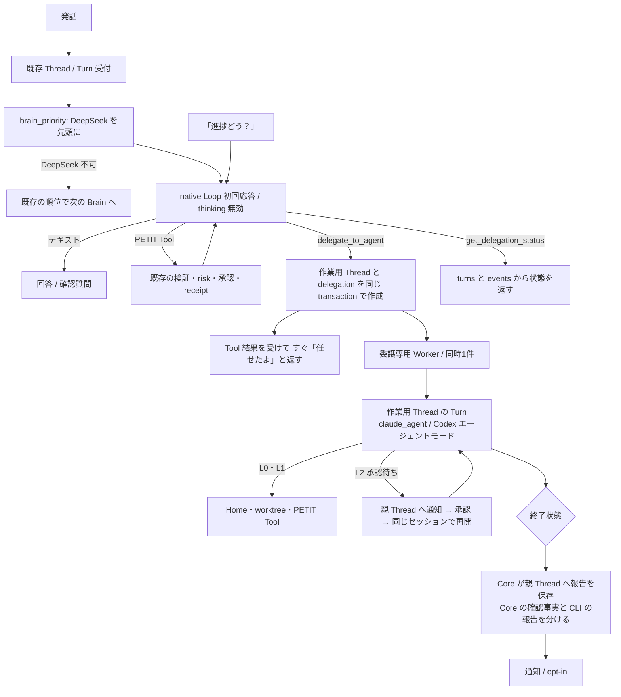

# Front Brain と CLI 委譲 — 普段はすぐ返し、重い仕事だけ任せる

> Status: **現行（v0.50.0 で実装・既定 OFF の試験機能・実 CLI での通し確認は未了）** / Last updated: **2026-11-09**
>
> 関連Issue: #411（近い既存Issue: #225、#338、#368）
>
> 関連文書: [Concept.md](../../Concept.md) §4・§10、[agent-home.md](agent-home.md)、[../core/ai-first-agent-design.md](../core/ai-first-agent-design.md)、[../runtime-flows.md](../runtime-flows.md)
>
> 実装フローの正本は [runtime-flows.md](../runtime-flows.md)。本書は設計の理由と範囲を書く。

## 0. 実装の状況（v0.50.0）

| 段 | 状態 |
| --- | --- |
| P0 計測 | **未実施**。§7 の評価と現行文脈での実測はまだ |
| P1 Front Brain | 実装済み。設定のトグル（既定 OFF）で有効。トグル OFF の動作は変えていない |
| P2 委譲 | 実装済み |
| P3 の一部 | 親 Thread での承認は実装済み。**`continue_delegation`、Discord での承認、`delegate_coding_task` の整理は未実装** |
| P4 既定の変更 | 未実施（`POLICY_ORDER` は変えていない） |

確認済み: 単体・回帰テスト、合成 Provider での実ブラウザ操作（設定画面、依頼 → 即応答 → 状態表示 → 報告）。

**未確認: 実 CLI での通し動作。** 2026-11-09 時点のこの PC では、`claude` が v2.1.126 で `--restricted` に未対応、かつ CLI が未ログインのため実行できなかった（デスクトップアプリのログインは CLI と別）。v2.1.317 でも未ログインで止まることまでは確認した。

本書の §3 以降は承認時の設計で、次の点だけ実装で確定した。

- `delegations` 表には `model` と `report_conversation_id` を足した。
- 委譲の作業はチャットのエージェントモード設定に関わらずエージェントモードで動く（設定 UI に明記）。
- Claude の委譲モデルは `delegate_claude_model`（`sonnet` / `haiku`、既定 `sonnet`）で選ぶ。
- 通知の文面に作業内容を含めない。

---

## 1. 要約

- 会話の最初の担当を CLI から **DeepSeek Flash（Front Brain）** に移す。
- 別の Router は作らない。既存の native Tool Loop の初回応答で「回答・確認質問・PETIT Tool・CLI 委譲」のどれかを選ぶ。
- CLI 委譲は普通の Tool（`delegate_to_agent`）にする。Front Brain はすぐ「任せたよ」と返し、CLI は**作業用 Thread** の Turn として裏で動く。
- 委譲先はエージェントモードを持つ CLI（Claude Code / Codex）だけにする。Antigravity CLI は当面対象外にする。
- 本番化の前に、振り分けの精度を未調整の発話で測る。

---

## 2. なぜ変えるか（実測）

ローカル DB の `turn_events` / `turns` を読み取り専用で確認した結果。サンプルは少なく、確定値ではない。

| 経路 | 標本 | 所要時間 |
| --- | --- | --- |
| Antigravity CLI、出力約40トークン | 3ステップ | 8.9〜9.8秒 |
| Antigravity CLI、出力400〜1,100トークン | 9ステップ | 11〜17秒（ほか外れ値 44.9秒が1件） |
| DeepSeek、1〜3コール（Tool 込み） | 11ターン（10月末、秒単位の記録） | 約1〜5秒 |

- CLI はおおよそ「9秒＋出力1トークンあたり約7ms」で動く（目測）。この9秒はステップごとの起動を含み、起動と推論の内訳は分からない。
- 全ステップで `cache_read_tokens` は 0。
- 43秒のターン（2026-11-09）は 9.4秒＋32.4秒で、Discovery を消しても約2割しか縮まない。当時は事後登録 Tool がなく、Thinking 3,078 トークンを使った末に「機能がない」と答えた非典型例である。
- DeepSeek の標本は当時の文脈量で測ったもので、現行の人格ファイル込みの値ではない。§8 の P0 で測り直す。

---

## 3. 全体の流れ（目標・未実装）



### 初回応答の4択

新しい応答形式は作らない。

| 選択 | 表現 |
| --- | --- |
| 回答 | テキスト、`tool_calls` なし |
| 確認質問 | テキスト、`tool_calls` なし |
| PETIT Tool | `tool_calls` |
| CLI 委譲 | `tool_calls` に `delegate_to_agent` |

別の振り分け呼び出しはしない。Python 側で発話を判定する分岐も足さない（v0.45.0 で撤去した旧ルーターに戻さない）。

---

## 4. Front Brain

### 4.1 変更点

- **順位**: 利用者が管理 UI で DeepSeek を先頭にする。新規導入時の既定（`POLICY_ORDER`）は §9 の決定後に変える。保存済みの順位は従来どおり書き換えない。
- **`cli_only`**: DeepSeek は許可されないので現行のまま動く。本設計は `mixed` のときだけ効く。
- **`local_only`**: 外部 Provider も委譲も使わない。現行の拒否を変えない。
- **system 指示**に次を足す。
  - 自分で完結しない作業は委譲を選ぶ。
  - 「できない」と答える前に、委譲で解決できるかを確認する。
  - 委譲していない作業を「やった」と言わない。

### 4.2 初回から渡す Tool の拡張

現行の `brain_catalog.DIRECT` は読み取りが中心で、書き込みには Discovery が要る。native Loop のときだけ、次を初回から渡す。CLI ステップの入力は増やさない。

| 区分 | Tool |
| --- | --- |
| 既存 | `get_current_time` `get_tasks` `get_schedule` `get_weather` `search_news` |
| 追加（生活） | `get_work_status` `start_work_session` `update_work_session` `record_past_work` `create_task` `complete_task` `create_reminder` `search_memory` |
| 追加（委譲） | `delegate_to_agent` `get_delegation_status` |

- `add_schedule` は確認付きのため今回は Discovery のままとし、利用頻度を見て判断する。
- `get_tasks` → `start_work_session` のように2コール以上かかる依頼は残る。DeepSeek の速度なら許容する。
- Tool の順序を固定し、人格・指示・一覧を先頭側に置く。現行も時刻は別メッセージなので、接頭辞キャッシュが効く可能性がある。効果は `prompt_cache_hit_tokens` で確認する（未測定）。

### 4.3 既知の不整合

`create_daily_briefing` は `DIRECT` にあるが `brain.PUBLIC_TOOLS` にないため、現行では公開されていないように読める。意図した動作かを P1 で確認する。

---

## 5. CLI 委譲

### 5.1 なぜ同じ Thread で続けないか

| 現行の制約 | 場所 | 帰結 |
| --- | --- | --- |
| Turn の Provider 固定 | `brain.py` `_run` | Turn の途中で CLI へ替えられない |
| Tool 実行後は Fallback しない | `brain_priority.run` | 同上 |
| 1 Thread につき実行中 Turn は1つ | `idx_turn_thread_busy` | 同じ Thread で動かすと、終わるまで会話できない |
| Turn の Worker は2本 | `conversation_api._executor` | 最大15分の作業で埋めると会話が詰まる |

そこで、**新しいジョブ基盤は作らず、作業用 Thread に既存の Turn を立てる**。承認・receipt・取消・events・`provider_sessions`・MCP トークンをそのまま使える。

### 5.2 Tool

| Tool | risk | 内容 |
| --- | --- | --- |
| `delegate_to_agent(goal, context_summary)` | `low_risk_write` | 委譲を受け付け、ID を返す。1 Turn に1件まで |
| `get_delegation_status(delegation_id?)` | `safe_read` | 状態・経過時間・承認待ち・報告を返す |
| `cancel_delegation(delegation_id)` | `low_risk_write` | 取消要求。実行済みの変更は戻さない |
| `continue_delegation(delegation_id, message)` | `low_risk_write` | P3。同じ作業用 Thread に次の Turn を立てる |

- 委譲の開始は確認しない。作業範囲が L0・L1 に閉じ、L2 は作業中に承認を取るため（Concept §4）。
- 冪等性は親の `request_id` と `call_id` から ID を導いて保証する。
- 管理者の Turn だけで使える。Guild モード・`local_only`・作業用 Thread（再帰防止）では公開しない。
- エージェントモードの CLI が会話 Brain のときも公開しない（自分で作業すればよい）。

### 5.3 データ

```sql
CREATE TABLE delegations(
  id TEXT PRIMARY KEY,
  parent_thread_id TEXT NOT NULL,
  parent_request_id TEXT NOT NULL,
  work_thread_id TEXT NOT NULL,
  work_request_id TEXT NOT NULL,
  goal TEXT NOT NULL,
  provider TEXT,
  reported_status TEXT,     -- 親へ最後に報告した状態
  reported_at TEXT,
  created_at TEXT NOT NULL
);
```

- 実行状態の正本は `turns.status` とし、別の状態列を持たない。
- 作業用 Thread は `source='delegate'`。ID は `delegate:<id>` とする。
- 作業用 `request_id` は `<親 request_id>:delegate:<番号>` とする。Discord の承認判定は `request_id` の `discord:` 接頭辞で行う（`discord_api.py`）ので、Discord 発の委譲はそのまま条件を満たす。

### 5.4 CLI へ渡す内容

Core が組み立てる。

1. **依頼の原文**（Core が転記する。モデルの要約に置き換えない）
2. `goal` と `context_summary`（Front Brain が書く）
3. 親 Thread の直近の会話（上限つき。提案: 6メッセージ・3,000文字）

他の Thread の履歴は渡さない。文脈に含まれる指示は、既存どおりデータとして扱う。

### 5.5 委譲先の選択

モデルには選ばせない。Core が次の条件で選ぶ。

- 接続済みで許可されている
- **エージェントモードが ON**（`claude_code_agent_mode` / `codex_agent_mode`）
- 順位は新しい設定 `delegate_priority` に従う。提案の既定は `claude_code` → `codex`

候補がなければ Tool はエラーを返し、Front Brain は「任せられる CLI がない」と正直に答える。

Antigravity CLI を外す理由: 1ステップごとに起動し直すため（`antigravity_cli_brain.completion`）、複数ステップだと起動の待ちだけで積み上がる。常駐ループかセッション継続が使えると確認できたら再検討する。

実装は `brain_priority.run` の候補を、`source='delegate'` の Thread では `delegate_priority` に替える。実行は `_run` の既存の分岐（`claude_agent.run` / `codex_brain.run`）に任せる。

### 5.6 Worker

- 委譲専用の Worker を1本持つ。同時実行は1件で、残りは `queued` で待つ（Home の git commit が競合しないように）。
- Turn の上限は `claude_agent` の 900 秒と MCP の 40 コールをそのまま使う。
- Core 再起動時は既存の `store.recover` で中断扱いにし、自動再実行しない。起動時に未報告の委譲を親へ報告する。
- `conversation_api.process` の会話成果物の保存（`_persist_chat_artifacts`）は作業用 Thread では走らせない。
- `list_threads` と UI の一覧から、作業用 Thread を既定で隠す。

### 5.7 親 Thread への報告

- 状態が変わったとき（承認待ち・完了・失敗・取消・中断）に Core が書く。**LLM を追加で呼ばない**。
- 親 Thread の `conversations` に `source='delegate'`、`user_text=''` で保存する。`history()` は空文字を飛ばす実装なので文脈は崩れないはず。UI の表示は未確認で、P2 で確かめる。
- 親に残すのは 2,000 文字まで（`history()` の上限 9,000 文字を占有しないため）。全文は作業用 Thread に残す。
- Concept §3-6 に沿って分けて書く。

```text
【任せていた作業: 完了】（Claude Code・4分12秒）
Coreで確認: Turn 完了 / Tool 7回 / 拒否 0回 / Home の commit あり
CLIの報告（未検証）: ……
```

- 通知は新カテゴリ `delegation` を足す。Concept §8 に従い初期 OFF とする。

### 5.8 承認

- 確認カードは作業用 Turn に紐づくが、親 Thread を見ている利用者に見えなければ止まったままになる。
- 親 Thread の報告に承認カードを出す。既存の `decide(approval_id)` は Thread に依存しないので、処理側の変更は小さいはず。
- 承認後は既存どおり同じセッションへ `--resume` する。期限切れは既存どおり取消になり、親へ報告する。

### 5.9 委譲で実際にできること

「ファイル調査」や「調べて」が何でも通るわけではない。現行の境界のまま、次の範囲になる。

| できる | できない（本設計では広げない） |
| --- | --- |
| PETIT Home の読み書き | Home と worktree の外のファイル探索（柱「ファイルを探して届ける」は未着手） |
| 登録 repo の worktree での開発・`run_worktree_check` | Web 調査（`claude_agent` は WebFetch / WebSearch を拒否） |
| PETIT Tool を組み合わせた複数ステップ作業 | Windows での Bash（`sandbox_ready` が False） |

PC 上のファイルを探す依頼は委譲しても達成できない。Tool の説明に範囲を明記し、範囲外はその場で「まだできない」と答えさせる。

### 5.10 `delegate_coding_task` との関係

当面は併存する。

- P2 の `delegate_to_agent` はコード変更を対象にしない。
- P3 で worktree 開発を開放するときに、どちらかへ統合するか決める。Tool が2つ並ぶと、Front Brain が迷うため。

---

## 6. 失敗の扱い

| 事象 | 動作 |
| --- | --- |
| DeepSeek が停止・残高不足 | Tool 実行前なら既存の Fallback で次の Brain へ |
| Tool 実行後に DeepSeek が停止 | 既存どおり Turn 失敗。委譲済みの作業は止めない |
| 委譲先がない | Tool エラー → 正直に伝える |
| CLI の認証切れ・利用枠切れ | 作業用 Turn の開始前なら `delegate_priority` の次へ。Tool 実行後は失敗として親へ報告 |
| 作業中に Core 再起動 | 中断として報告。自動再実行しない |
| Front Brain が委譲すべき依頼に自分で答えた | エラーにならない。§7 で測り、利用者が「CLIで調べて」と言い直せば委譲できる |

---

## 7. 評価（P0）

既存の `experiments/` の評価方式を流用し、合成データだけで実 DeepSeek を呼ぶ。発話は調整に使っていないものを 30 件以上用意する。

| 分類 | 例 |
| --- | --- |
| 雑談 | 挨拶、相談 |
| 定型の読み書き | 予定確認、タスク追加、作業開始、事後登録 |
| 委譲すべき | Home のメモ整理、repo の調査、複数ステップ作業 |
| 委譲してはいけない | 雑談、単純な予定確認 |
| 範囲外 | PC 全体のファイル探索 |
| 誤操作を誘う | 引用・仮定・否定（#338 と同じ観点） |

移行条件の提案（数値は本人の判断で調整する）。

| 指標 | 条件 |
| --- | --- |
| 引用・仮定・否定の誤 Write | 0件（#338 の移行判定を継承） |
| 実行していない操作を成功と言う | 0件 |
| 委譲漏れ（自分で答えた、できないと答えた） | 10%以下 |
| 過剰委譲 | 10%以下 |
| 雑談のコール数 | 1 |
| p95（雑談 / 定型） | 3秒以下 / 8秒以下 |

自動判定で通っても自然文の品質は別に目視する（#338 で、自動判定を通過した引用翻訳の失敗があった）。人格の再現（SOUL.md の口調）も本人が比較する。

本番の計測として、委譲の有無、`prompt_cache_hit_tokens`、1 Turn の総トークンを `brain_call_metrics` で確認する。現行の DB には `usage` が空の1件しかないので、記録されるかを先に確かめる。

---

## 8. 段階導入

| 段 | 内容 | 完了条件 |
| --- | --- | --- |
| **P0 計測** | コードはほぼ変えない。計測の確認、§7 の評価セット作成、順位変更での試用 | 現行文脈での p50 / p95 とキャッシュ率が取れている |
| **P1 Front Brain** | native 限定の Tool 拡張、system 指示、Concept §4・§10 の更新 | §7 の誤 Write と誤成功が 0件。委譲以外の指標を満たす |
| **P2 委譲（L0）** | `delegate_to_agent` / `get_delegation_status` / `cancel_delegation`、作業用 Thread、Worker、親への報告、通知 | 実 CLI（Windows）で依頼 → 即応答 → 裏で完了 → 親に報告が通る。作業中も親で会話できる |
| **P3 委譲（L1・L2）** | worktree 開発、親 Thread での承認、`continue_delegation`、Discord、`delegate_coding_task` の整理 | 「Issue → ブランチ → テスト → PR（承認）」が親 Thread から通る |
| **P4 既定の変更** | `POLICY_ORDER` と文書の更新。本番利用の結果を見て判断 | 本人の継続利用で問題がない |

実装の各段で `docs/runtime-flows.md` の図、`docs/architecture.md`、`PROGRESS.md` を同じ変更で更新する。

---

## 9. 決定事項（2026-11-09、本人）

| # | 問い | 決定 |
| --- | --- | --- |
| D1 | 普段の会話の個人データを DeepSeek へ送ってよいか | **送ってよい**。ただし Gmail 本文（`gmail_get_message`）は Front Brain の公開対象から外し、必要なら CLI に任せる |
| D2 | DeepSeek を最初の担当にするか | **まず試す**。設定のトグル（既定 OFF）で切り替える |
| D3 | 委譲先 | 既定は Claude Code → Codex。順位は設定で変更できる。Claude は Sonnet / Haiku から選ぶ |
| D4 | 委譲の開始を確認するか | **確認しない。ただし利用者に見えるようにする**（返答末尾の Core の一文と、チャット上部の状態表示） |

---

## 10. 未確認

- 実 CLI での通し動作（§0）。`claude update` と `claude login` の後に確認する。
- DeepSeek のデータの扱い（保管場所・学習利用）の最新の公式ポリシー。D1 の判断前に確認する。
- 現行の文脈量での DeepSeek の速度・キャッシュ率・料金。
- DeepSeek Flash の振り分け精度。#338 は 7 Tool の範囲で、thinking 無効の比較のみ。
- Windows での Claude Code エージェントモードと MCP・Hook の動作（agent-home §4.3 で未確認）。実 Codex のエージェントモードも未確認。
- CLI を自作アプリから呼ぶ使い方の規約上の扱い（Concept §10）。本設計は呼び出し回数を減らすが、解消はしない。
- 親 Thread の `user_text=''` の行が Web・Desktop・Discord でどう表示されるか。
