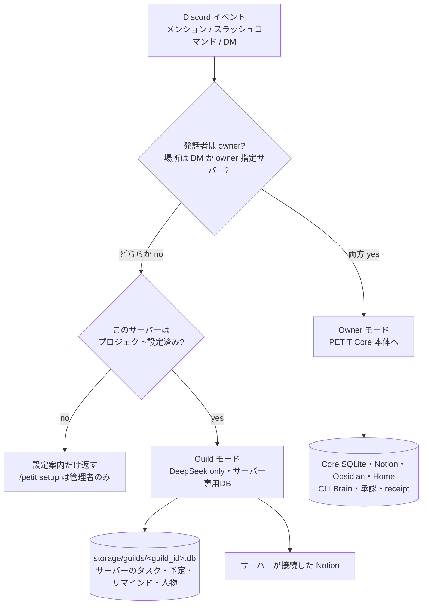

# PETIT Discord Bot — 本人専用モードと「サーバー向けプロジェクトモード」

> Status: **目標（方針承認済み 2026-11-08・未実装）** / Last updated: **2026-11-08**
>
> 関連: Concept.md §2・§6・§9・§10、[multimodal-discord-plan.md](multimodal-discord-plan.md)（旧計画。PR3/PR4 の Discord 部分を本書が引き継ぐ）、[../brain/agent-home.md](../brain/agent-home.md)
>
> Guild モード（§3）は Concept §2 に「副産物」として追記済み（2026-11-08）。owner データとの完全分離が条件。

---

## 1. 2つのモード

1つの Bot アカウントで、**話しかけた人と場所**によってモードを切り替える。人格（プティのキャラクター）は同じだが、記憶・データ・Brain・道具は完全に分ける。

| | Owner モード | Guild モード |
| --- | --- | --- |
| 条件 | 発話者 = owner の Discord user ID **かつ** DM または owner が指定したサーバー | それ以外（owner 以外の人、または指定外のサーバー） |
| 中身 | PETIT 本体。Web / Desktop と同じ Thread 台帳・記憶・タスク・開発の司令塔 | サーバーごとのアシスタント。そのサーバーのタスク・予定・リマインド・メンバー |
| Brain | 既存の優先順位（CLI → DeepSeek） | **DeepSeek のみ** |
| データ | Core（`storage/app.db` など） | サーバー専用 DB。owner のデータには**一切届かない** |
| 道具 | 既存 Tool Registry（承認つき） | Guild 用の小さな catalog（下記）だけ |

owner が指定外のサーバーで話しかけた場合も Guild モードになる（そのサーバーで owner の個人情報を出さないため）。

### なぜ Guild モードは DeepSeek だけか

- owner 本人の CLI サブスクリプション（Claude Code / Codex / Antigravity）を他人の利用に使わない。規約上も本人利用の範囲を守れる。
- 費用を API の従量で管理でき、サーバーごとに予算を切れる。
- CLI の組込みTool・Home に他人の発話が届く経路をそもそも作らない。

---

## 2. Owner モード（最高の自分専用Bot）

Concept §6 の「Discord Bot：自分専用に常駐」をここで実装する。

- **会話**: DM と指定サーバーでメンション / `/petit`。`source=discord` で Core の Thread / Turn に入る（API は受付済み）。Discord のチャンネル（またはスレッド）ごとに Core の Thread を1つ対応させる。
- **長い返答と待ち時間**: 3秒以内に defer、Core の Turn 完了を待って 2000 文字単位で分割、またはファイル添付で返す。
- **承認**: 確認カードを Discord のボタン（承認 / 取消）で出す。押せるのは owner だけ。承認の消費は既存 Core の仕組み。
- **通知**: リマインダー・予定の前・Job 完了を DM へ配送（既存の通知イベントの配送先に Discord を追加。カテゴリは初期 OFF：Concept §8）。
- **開発の司令塔**: 「@PETIT WEVORA の続き進めて」→ [agent-home.md](../brain/agent-home.md) の Job として開始、進捗をスレッドに流す、PR は承認ボタン。
- **個人情報の出し先**: 予定・タスク・記憶の中身は DM では返す。指定サーバーのチャンネルでは要約のみ・詳細は DM へ、を既定にする（Concept §10 の未決定事項への提案）。
- **ファイル**: 添付は Home の `inbox/` に受け取り、渡すものは `outbox/` から確認後に送る。

---

## 3. Guild モード（サーバー向けプロジェクト）

### 3.1 プロジェクト設定

- サーバーの管理者（Discord の Manage Server 権限を持つ人）が `/petit setup` を実行して初めて有効になる。未設定のサーバーでは、何を聞かれても設定案内しか返さない（DeepSeek も呼ばない）。
- 設定項目: 有効化、使うチャンネル、タイムゾーン、Notion 連携（任意）、1日の利用上限、リマインドの送信先チャンネル。
- **Notion 連携**: サーバー側が自分の Notion internal integration token と対象 DB を登録する。入力は Discord の modal（本人にだけ見える）で受け、暗号化して保存し、二度と表示しない。owner の Notion とは別の接続として扱う。
  - Notion の公開 OAuth は外部から到達できるリダイレクト URL が要るため、インターネット非公開（Concept §8）の方針では最初は使わない。
- `/petit reset` で設定とサーバーのデータを消せる。

### 3.2 できること（Guild 用 catalog）

| 機能 | 内容 |
| --- | --- |
| タスク | サーバーの共有タスク。担当者（メンバー）・期限・状態。Notion 連携時は Notion を正本、DB はミラー |
| スケジュール | サーバーの予定（イベント・締切）。Discord の Scheduled Event との連携は後で検討 |
| リマインド | 「明日 20 時に @A さんへ提出リマインドして」→ 指定チャンネルで担当者にメンション |
| 人の認知 | Discord user ID ごとのメンバープロフィール（呼び名、担当、メモ）。「A さんって何担当？」に答える |
| 会話 | プティの口調で雑談・相談。サーバー内の記憶だけを使う |

- 書き込み（タスク作成・リマインド登録）は Discord のボタンで確認してから。誰でも押せるか管理者だけかは設定で選ぶ。
- 他サーバー・owner の情報、Web 検索、ファイル操作、コード実行は **catalog に載せない**（出来ない、が保証になる形にする）。

### 3.3 人を認知する — プライバシーの線

- 覚えるのは「その人がプティに話しかけた内容」と「管理者・本人が登録したプロフィール」だけ。チャンネルの全メッセージは読まない（Message Content Intent を使わず、メンション・スラッシュコマンドで受ける）。
- `/petit me` で自分について覚えていることを見られ、`/petit forget-me` で消せる。
- 人物の記憶はサーバーごとに分け、サーバー間で同じ人を紐づけない。

### 3.4 分離と費用

- データはサーバーごとに別の SQLite ファイル（`storage/guilds/<guild_id>.db`）。テナントキーで1つの DB を分けるより、取り違え事故が起きにくい。
- Guild モードの処理は owner の Core 会話ループと別の経路（別 catalog・別 Brain 設定・別 DB 接続）で動かし、request_context に `mode=guild` を必ず載せる。owner の Tool を呼ぼうとしたら即失敗にする。
- サーバーごとに 1日のトークン上限、ユーザーごとのレート制限。上限に達したら「今日はここまで」と返す。使用量は owner の管理画面で見られる。

---

## 4. 構成

- Bot は **Core と別プロセス**（`backend/channels/discord/` に置き、`python -m backend.channels.discord` で起動）。Discord Gateway へは外向き接続だけなので、Core をインターネットに公開しなくてよい。
- Bot → Core は localhost / Tailnet 上の API に、Bot 専用のサービストークンで接続する。Owner モードは既存の `/api/chat`（`source=discord`）、Guild モードは新しい `/api/guild/*`。
- ライブラリは discord.py を想定（依存追加は Issue で確認してから）。
- 冪等性: Discord の interaction ID / message ID を request ID として使い、再送で二重実行しない（既存の request ID 再送ルール）。

---

## 5. 段階導入

| 段 | 内容 | 完了条件 |
| --- | --- | --- |
| **D1 Owner MVP** | Bot プロセス、owner 判定、DM とメンション、Core Thread 対応、defer・分割 | DM で予定・タスクに答える。owner 以外・指定外サーバーには何も個人情報を返さない（テスト） |
| **D2 Owner の承認と通知** | 承認ボタン、リマインダー・Job 完了の DM 配送 | 承認が owner だけ・一度だけ。通知 OFF のカテゴリは送らない |
| **D3 Guild の土台** | `/petit setup`、サーバー専用 DB、DeepSeek only の会話、予算 | 未設定サーバーで DeepSeek 0 回。Guild から owner Tool へ届かない（テスト） |
| **D4 Guild のタスク・予定・リマインド** | catalog、確認ボタン、リマインド配送 | 実サーバーで登録 → 期日にメンションが届く |
| **D4.5 Cloudflare 配送（任意）** | 無料枠を確認できたら、Guild のリマインドを Worker の Cron で配送 | PC 停止中でも期日に届く。送信済みが PC の台帳へ戻る。無料枠内 |
| **D5 Notion 連携・人の認知** | modal での token 登録、Notion 正本の同期、メンバープロフィール、forget-me | Notion 側の変更が反映。forget-me 後に何も答えない |
| **D6 開発の司令塔を Discord から** | agent-home の Job を Discord スレッドで操作 | 「進めて → 進捗 → PR 承認」が Discord だけで完結 |

D1〜D2 は agent-home（H1〜H3）と並行できる。D6 は H4 の後。

---

## 6. どこで動かすか — 自宅PC＋Cloudflare（検討）

**決定（2026-11-08）: 基本は自宅PC。** Cloudflare は無料枠に収まる場合だけ、PC 停止中に止まると困る部分に使う。

### 6.1 役割分担の案

| 担当 | 自宅PC | Cloudflare（任意） |
| --- | --- | --- |
| Discord Gateway（メンション・会話） | ○ 常駐プロセス | ×（Worker は長時間の WebSocket 接続を保てないため置かない） |
| Owner モード全部 | ○ | ×（owner のデータは置かない：Concept §8） |
| Guild の会話・タスク・Notion | ○ | × |
| Guild のリマインド配送 | ○（PC 稼働中） | ○ Cron Trigger が期日の通知を Discord REST API で送る |
| PC 停止中の案内 | — | 任意: 「いまは本体がお休み中です」を返す程度 |

- PC は Guild のリマインド予定を、外向きの HTTPS で Worker の小さな保存先（D1 など）へ写すだけ。Worker から自宅PCへ入る経路は作らない。
- Worker に置くのは「サーバーID・チャンネルID・メンション先・本文・期日」だけ。送信済みは PC 側が取りに行って台帳に反映する（送信済み / 未送信 / 不明 を区別：Concept §8）。
- Bot token を Worker の Secret に置くことになる。漏えい時の影響が Bot 全体に及ぶため、Worker の権限は送信だけに絞る。
- Slash コマンドを HTTP（Interactions Endpoint）で受けるように設定すると、Gateway 側には届かなくなる。PC 停止中の案内のためだけに切り替えない（実装時に公式仕様で再確認）。

### 6.2 無料枠の確認（未確認・実装前に公式で確かめる）

- Workers 無料枠の 1 日あたりリクエスト数、Cron Trigger の本数、D1 の保存量と読み書き回数の上限。
- 想定負荷: リマインド配送は 1 分ごとの Cron でも 1 日 1,440 回程度なので、少数のサーバーなら無料枠に収まる見込み。超えそうなら Cron 間隔を 5 分にする。
- 枠を超える・有料化が必要になるなら Cloudflare は使わず、「PC 停止中はリマインドが遅れる」と Guild 側に明示する。

### 6.3 段階

D1〜D5 は自宅PCだけで作る。Cloudflare 配送は D4 の後に **D4.5** として、無料枠の確認が取れてから追加する。

## 7. 残りの問い

| 項目 | 状態 |
| --- | --- |
| Bot の置き場所 | **決定**: 自宅PC。Cloudflare は無料枠なら Guild 配送だけ（§6） |
| Concept §2 の改訂 | **決定・反映済み** |
| Guild の書き込み確認を誰が押せるか | 未決定。提案: 既定は管理者だけ、サーバーごとに「誰でも」に変更可 |
| owner 指定サーバーと個人情報の出し方 | 未決定。提案: DM では返す、指定サーバーのチャンネルでは要約のみ（§2） |

## 8. 未確認

- Discord の DM での Message Content Intent の扱いと、slash コマンドだけで足りるか（旧計画の調査メモを実装時に公式で再確認する）。
- DeepSeek の現行料金とサーバーあたりの想定コスト。
- Notion internal integration をサーバー側が用意する手間（案内文の検証）。
- Cloudflare 無料枠の現行の上限と、Worker から Discord REST API へ送るときのレート制限（§6.2）。
