# PETIT Runtime Flows

## #368: Workspace・永続Provider補助Thread・動的Tool公開

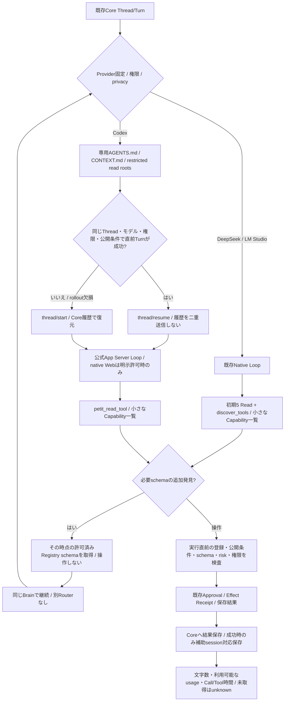

SDK旧選択は停止して再選択が必要。guestはToolもNative Webも禁止。local_onlyは外部Readを公開せずCodexへ送信しない。
未設定のGmail/Notion/ローカル開発Toolを除外するが、内部Task/予定/Reminder/Memoryは空データでも利用可能。
Tool Discoveryは最大8名ずつ、完全schemaを返す。内部承認Toolとbackgroundキュー作成は公開しない。
承認待ち・失敗・取消・権限変更では補助Threadを再利用せず、Core保存状態から復元する。
AGENTSは認可境界ではなく、read-only sandbox・機能無効化・Core bridge検証が境界。モデルの個人情報を含む検索語を完全検出するDLPは未実装で、Webは既定OFF。


## v0.34.3: Sona Core / Linkraft撤去（#363）

現行の`get_schedule`は既存Tool Registry、`add_schedule`は現在の承認・実行経路で処理する。Sona専用分岐は削除する。
Project Source RefreshはNotion/GitHub/BRAINを維持し、既存のLinkraft source linkはデータを保持して`skipped`とする。旧図の旧Runtime/承認フローは履歴・比較用であり、現在のRenaissance Core正本は上位のThread/Turn/Receipt図に従う。

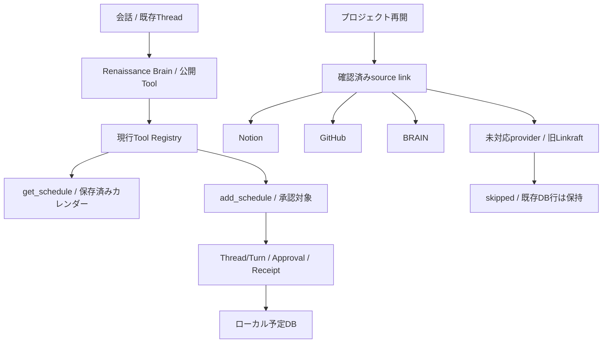


## v0.34.1: Antigravity CLI準備・本番無効（#355）

CLIのGoogleログイン・既存契約枠はSDK/LM Studioとは別。FAQ/規約とフォーラムの矛盾が
未解決のため、本番Providerに追加していない。`antigravity_cli`の明示指定は拒否し、
他Providerへ暗黙変更しない。Thread/Turn/Approval/Receiptの既存正本を維持する。

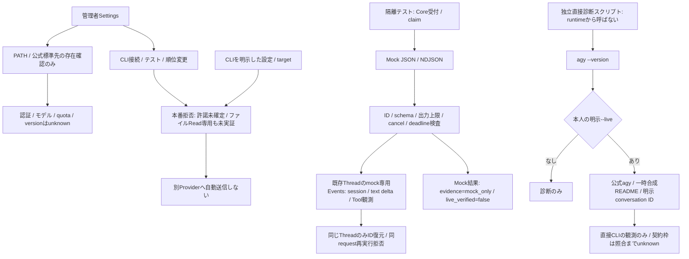

Tool観測は事後情報でありPETIT Toolの再実行や事前承認には使わない。Mockでは
通常のmodel_backend/receiptを生成しない。独立スクリプトの取消/deadlineは所有process
treeを終了するが、実agyでの動作は未検証。詳細: [CLI統合の状態](antigravity-cli.md)。

## Antigravity ACP setup and restricted readiness (#357)

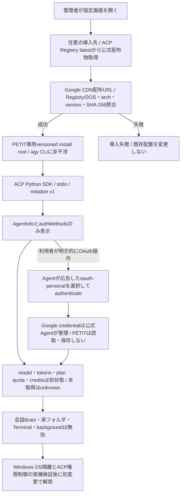

initialize handshakeはモデル推論・認証成功・Google契約枠の使用を証明しない。ACP Agentが内部Toolを直接実行するため、PETITのPermission callbackだけではWindows上のファイル書込みやShellを遮断できない。OSレベルの隔離とPETIT既存Approval/Receiptへの正確な接続が完成するまで、会話Providerとしては公開しない。既存 `agy` CLI診断は維持する。Antigravity SDKは#368で撤去済み。

## v0.34.0: 初期設定・優先順位と単一Brain（#353）

管理UIの順位設定がONなら新しい選択経路、OFFなら従来の明示Provider選択を使う。
本文・Thread/Turn・承認・receiptは既存SQLiteが正本で、下記の旧1〜10は移行前の参考資料。

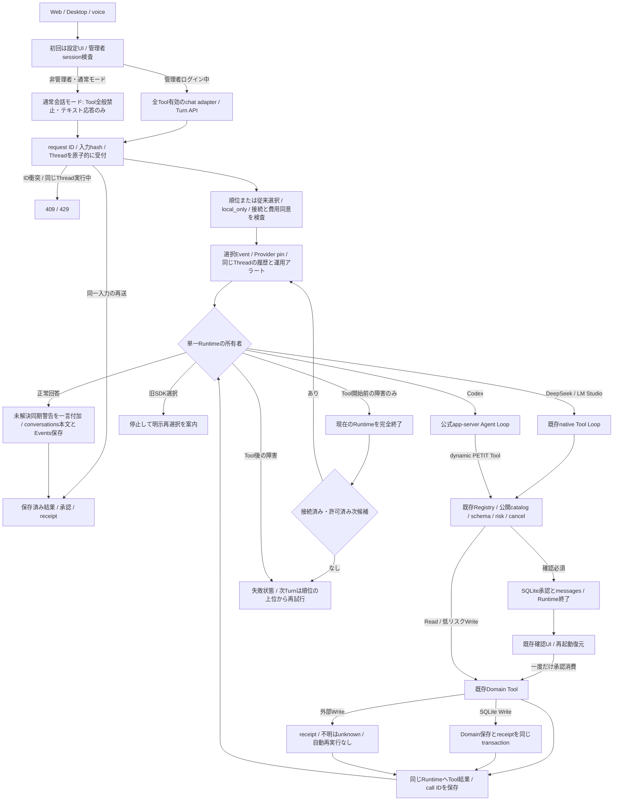

SDKは撤去済み。Codexのshell/apps/plugins/subagentは無効、許可していないserver requestは拒否する。各Runtimeを終了してからFallbackし、Tool実行後はLoopを再開しない。
画像は既存Vision観測→Read専用回答で、画像Providerの順位Fallbackは未対応。
8 rounds / 12 callsと取消/deadlineを維持し、local_onlyは外部へ送らない。

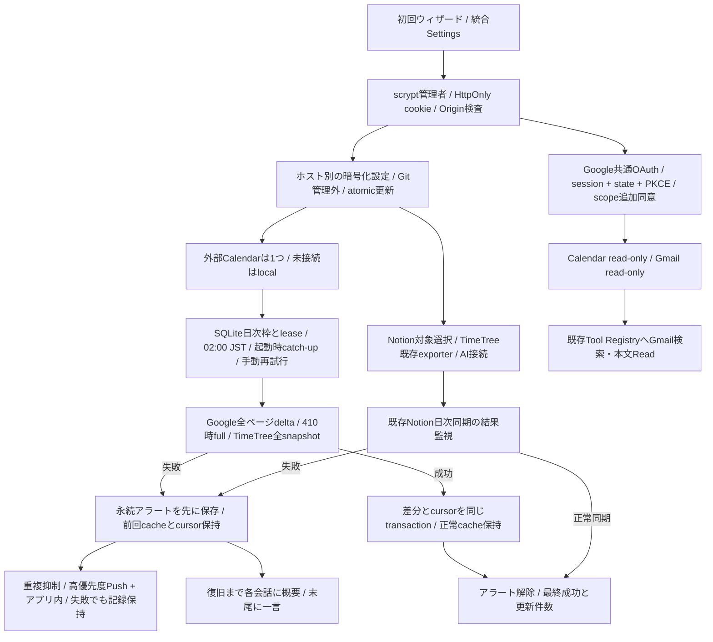

外部Calendarへの自動書き戻しはなく、Google双方向は未実装。詳細・認証前提・未確認事項は
[初期設定と接続](setup-integrations.md)。既存SDK実証は[SDK導入記録](antigravity-brain-poc.md)、
Coreの所有権・DB互換は[renaissance-core.md](renaissance-core.md)。


Thread/Turn/Eventsの現行経路は上図を参照する。[Desktop・共通Core基盤設計](desktop-foundation-design.md)（#301）全体の端末・管理機能の完成を示すものではない。

[AI-First設計と比較PoC](ai-first-agent-design.md)（#338）の実験を経て、通常text経路を上図へ移行した。以下の旧会話図は移行前の参考資料である。

この文書は、PETITの会話処理、PETIT Brain、Context Broker、Capability選択、Tool Calling、確認付き書き込み、進捗表示の実装フローを可視化したものです。

## ローカル開発観測（#341 / Opt-in、開発ブランチ）

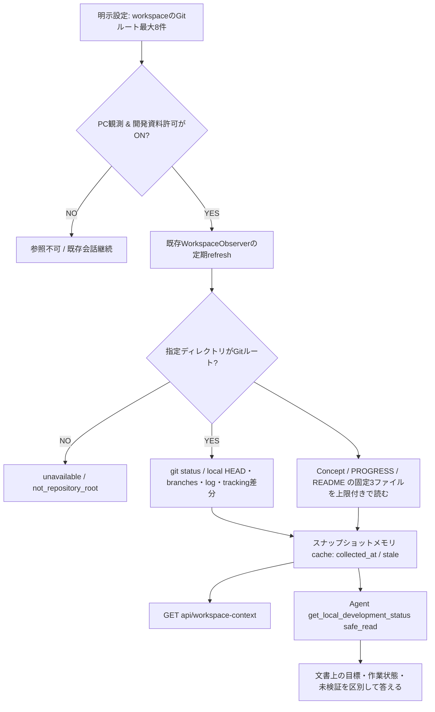

設計詳細と安全境界は [local-development-insight.md](local-development-insight.md)。ローカル参照はfetch/pullしない。文書内の指示を実行しない。GitHub最新・実機テスト済み・プロジェクト完了は別の証拠が必要。Toolは既存観測キャッシュを参照するだけで再走査しない。

## 作業統計タブ（v0.28.0 / #319・#321）

```mermaid
flowchart TD
    tab[統計タブを開く / 表示中30秒 / 手動更新] --> read[今日と直近7日の既存APIを並列取得]
    read --> today[/api/work-sessions/today]
    read --> week[/api/work-sessions/summary?days=7]
    select[日付入力 / 日別の棒] --> day[/api/work-sessions/days/DATE]
    day --> core
    day --> note[日付別の振り返りとrevisionを取得]
    today --> note
    note --> edit[入力と未保存の下書きを保持]
    edit --> save[明示保存 PUT days/DATE/reflection]
    save --> check{SQLiteトランザクションでrevision一致?}
    check -->|一致| stored[メモ保存 / revision更新]
    check -->|不一致| conflict[409 / 入力保持 / 保存済みの再読込を案内]
    today --> core[Coreで休憩とJSTの日境界を集計]
    week --> core
    core --> display[今日の合計・件数・最長 / 日別とタスク別グラフ / 記録]
    read -->|一部失敗| partial[成功分を表示 / 残す値は前回と明記]
    read -->|15秒経過| timeout[取得中断 / 更新で再試行]
    leave[タブ切替・非表示] --> cancel[未完了の取得中断 / 非表示の定期取得停止]
```

表示は `frontend/today.js` / `frontend/statistics.css`、集計は既存 `backend/work_sessions.py`。既存の集計を共用し、日別取得API・振り返りの明示保存APIと専用SQLite表を追加する。今日の既存APIにも振り返りを付加し、作業記録は変更しない。[画面と検証範囲](work-statistics.md)を参照。

## Desktopの画面準備と復旧（v0.28.0 / #321）

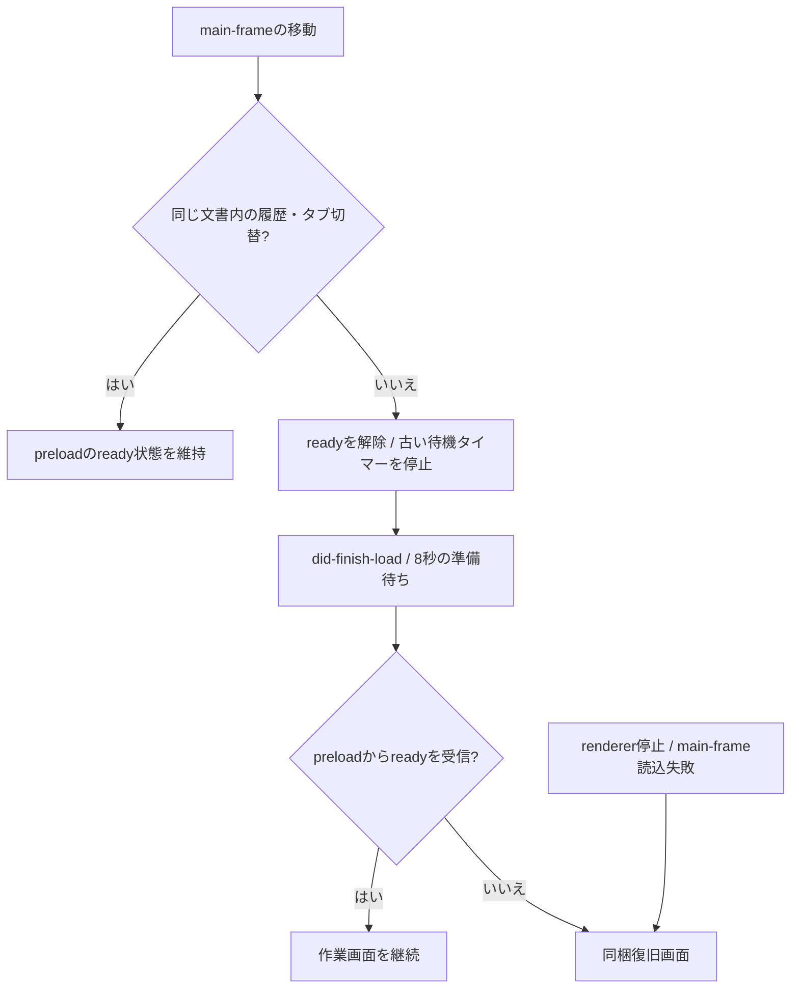

## Desktop v0.26.0の入力・同期競合・通知

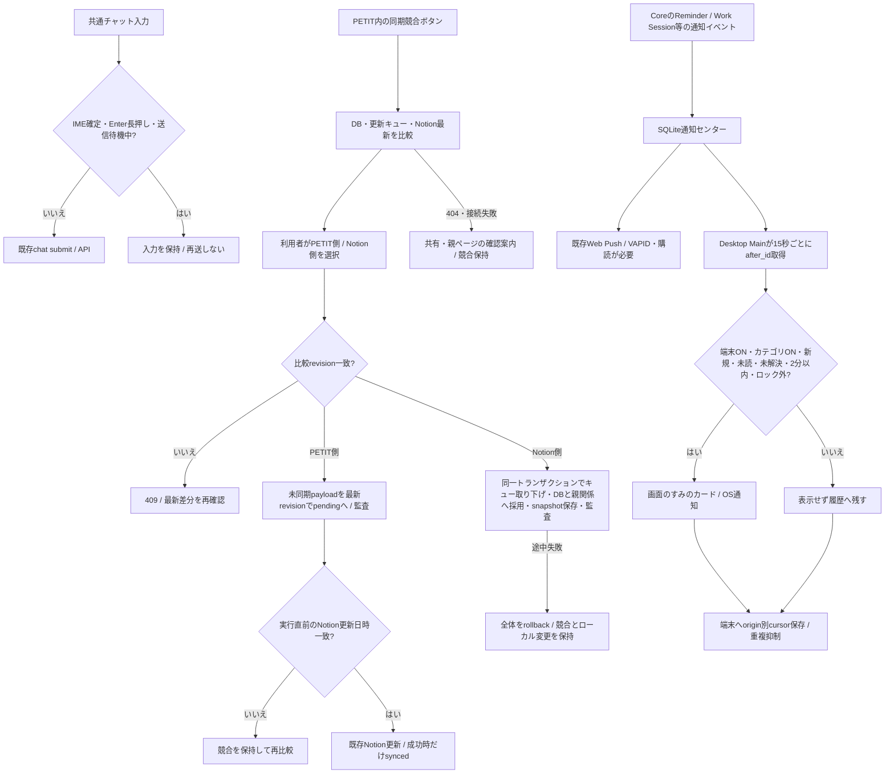

新しいThread/Turn/Core管理APIは追加していない。詳細と実機未確認は [desktop-v26-experience.md](desktop-v26-experience.md)。

実装の根拠:

- `backend/main.py`
- `backend/chat.py`
- `backend/chat_models.py`
- `backend/pending_actions.py`
- `backend/agent.py`
- `backend/brain_runtime.py`
- `backend/context_broker.py`
- `backend/workspace_context.py`
- `backend/petit_prompt.py`
- `backend/agent_runtime.py`
- `backend/capability_router.py`
- `backend/situation.py`
- `backend/time_context.py`
- `backend/work_sessions.py`
- `backend/tools/work_sessions.py`
- `backend/task_work_intent.py`
- `backend/tools/registry.py`
- `backend/agent_state.py`
- `backend/agent_progress.py`
- `backend/project_router.py`
- `backend/task_completion_intent.py`
- `backend/dialogue_state.py`
- `backend/dialogue_resolution.py`

---

## 1. 会話全体フロー

### 画像添付のRead専用経路（v0.31.0 / #333）

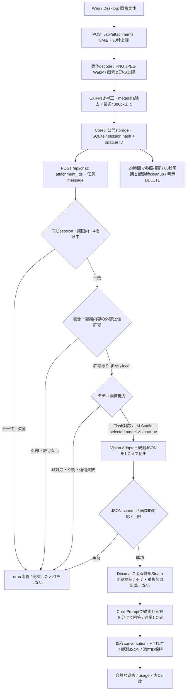

画像経路は `agent.run` / Capability選択 / Tool Loopへ入らず、画像内の命令からWrite・承認を生成しない。外部送信は `PETIT_ALLOW_CLOUD_IMAGES` が既定OFF。VisionのProviderは既存DeepSeek Flashを優先し、`PETIT_VISION_PROFILE=local` の場合はLM Studio `/api/v1/models` の選択モデル `capabilities.vision=true` が必要。未確認モデルは失敗にする。観測の回答生成先が外部の場合も同意を再検査する。通常2 Call、空出力再試行は最大各1回。HTTP timeoutは画像経路で各45秒。画像経路のMarkdown/Chroma自動exportは停止し、認識JSONは24時間で削除する。既存会話の返答/添付IDは既存履歴の保持方針に従う。

画像とProject/GitHubの自動照合、Discord、新Thread/Turn APIはこの経路に未接続。後続は [計画](multimodal-discord-plan.md) と #245/#246/#303/#304を参照する。session IDは既存ローカルClientの会話境界であり、インターネット公開用のユーザー認証ではない。

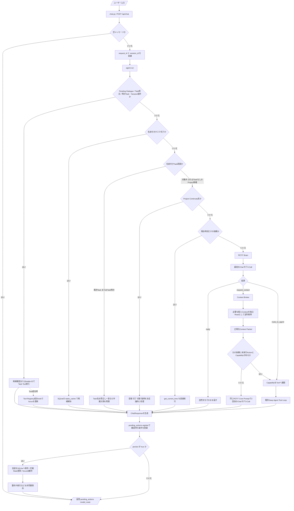

`backend/chat.py` が `/api/chat`、Agent実行、observability、Pending Action登録、SQLite会話保存、Chroma/Markdown artifact保存を所有します。`backend/main.py` はChat Routerを登録するだけで、会話実装の詳細を持ちません。

PETITの人格と会話原則は `petit_prompt.py` のCore Promptを正とします。Tool不要の雑談・相談・説明・文章作成は最初の1 LLM Callで終了します。Broker対応sourceのReadだけ不足する会話は `Brain -> Context Broker -> Brain` の原則2 Callで完了し、書き込みや対象外・複雑処理は既存Deep Agentへ進みます。

---

## 2. PETIT Brain / Context Broker

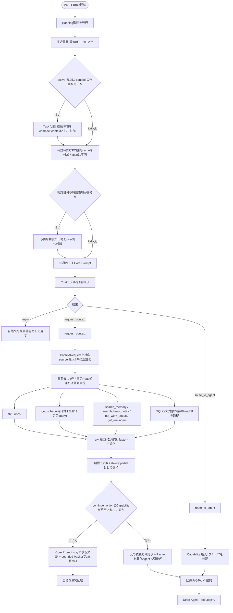

日時はsystem promptへ毎ターン結合せず、相対日付・相対時刻があるターンだけuser側へ注入します。active / pausedのWork Sessionがある場合だけ、小さいuser contextをConversation Entryへ付加します。

Context Brokerは `tasks` / `calendar` / `memory` / `brain` / `work` / `reminders` / `handoff` に対応します。 Calendar Readは日付またはキーワード`query`を`get_schedule`へ渡し、両方未指定なら`date_or_query_required`を返します。TimeTree等のSQLiteキャッシュの題名・説明・場所を検索し、日付未指定の検索では未来を優先します。Brokerは具体Tool名をLLMへ大量公開せず、固定したRead処理へ変換し、Toolのriskも実行直前に検証します。独立sourceは最大4件を並列取得し、各source約2500文字のfacts、記録時刻、鮮度、切詰めの有無を返します。詳細なsource対応表は [jarvis-agent.md](jarvis-agent.md) を参照。

`PETIT_CONTEXT_BROKER_TIMEOUT_SECONDS`（既定10秒）を超えたReadを待ち続けず、取得済みの部分結果を返します。実行中のproviderは強制停止できないため終了まで共有枠を占有し、新規要求は枠がなければ`source_busy`。実行待ちのキューを無制限に積みません。不正応答、providerエラー、staleを0件の成功として扱いません。2回目Callにも入口のactive work等を引き継ぎます。

### Call数の基準

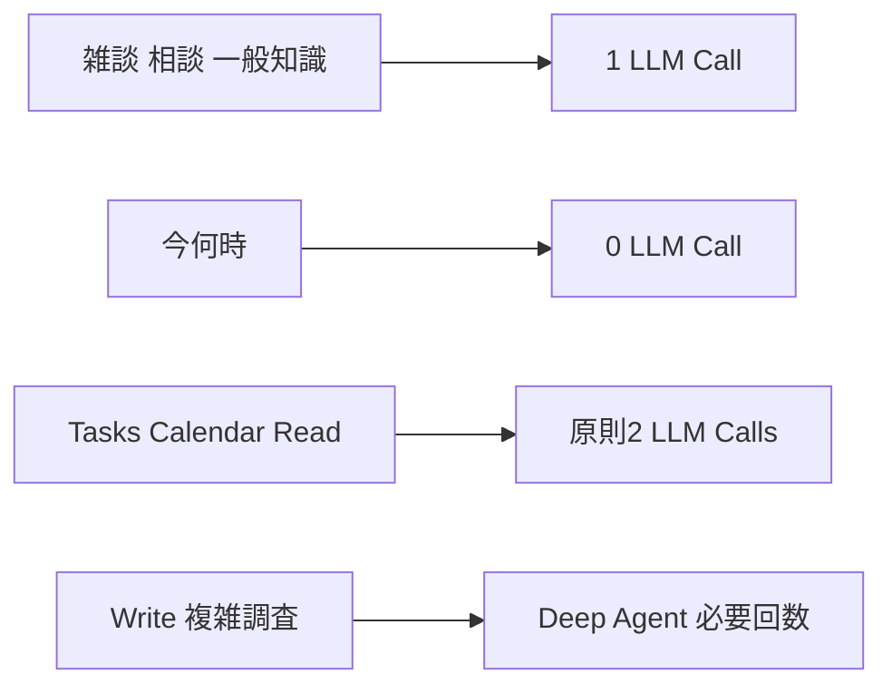

### Capabilityと公開Tool

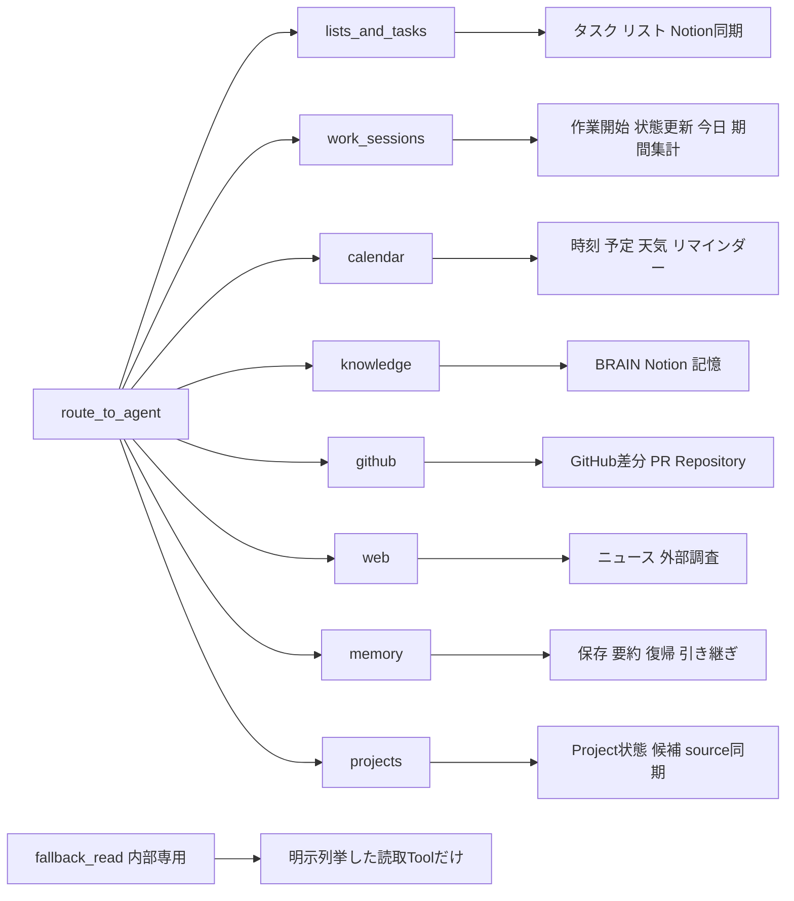

`fallback_read`はSelectorへ公開しない内部グループです。Context Broker対象外の安全なfallbackまたはDeep Agentでだけ使用し、書き込みToolを含めません。

### 作業記録

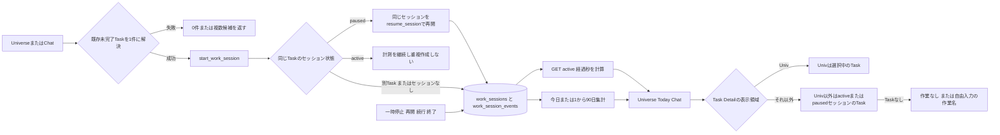

Notion Task DBへ作業時間プロパティは追加しません。SQLiteのセッションへPETIT内部`task_id`を保存し、Notionを含むタスク正本と参照で結びます。開始・一時停止・再開・終了はイベントとして残すため、日付をまたぐ休憩も暦日単位で集計できます。`start_work_session`と`update_work_session`は明示依頼時の低リスク書き込み、`get_work_status`と`get_work_report`は読み取りです。

「HERE再開」「HEREタスク再開」「HERE作業再開」はProject判定より前にSQLiteの既存未完了Taskを照合します。入力どおりの完全一致、末尾の「タスク／作業」を除いた完全一致、一意な部分一致の順で解決し、複数候補では書き込みません。Task明示で0件ならTaskが見つからない旨を返し、Project登録へ流しません。Projectを明示した入力は従来経路を維持し、同名TaskとProjectがある省略入力は選択を求めます。終了済みの作業は保持して新しい計測を開始し、Taskの状態自体は変更しません。

---

## 3. Agent Tool Loop

```mermaid
flowchart TD
    call[Agentモデルを呼ぶ]
    hasCalls{Tool callがあるか}

    answer[回答本文を取得]
    empty{回答が空か}
    fallbackAnswer[言い換えを求める固定文]
    incomplete{作業予告・重複確認またはActionにWrite実行結果がないか}
    retryUsed{再実行済みか}
    forceTool[このターンでTool callするよう再指示]
    deferredFail[未実行を明示した失敗回答]
    finalizing[finalizing進捗を発行]
    final[/最終回答/]

    roundLimit{Toolラウンド上限か}
    stopRound[tool_iteration_limitで停止]
    normalize[Tool callsを正規化]
    each[各Tool callを処理]
    totalLimit{Tool総数6回に到達か}
    stopTotal[tool_call_limitで停止]
    allowed{公開済みToolか}
    notAllowed[tool_not_allowed結果]
    args{引数検証に成功したか}
    badArgs[invalid_tool_arguments結果]
    duplicate{同じToolと引数を実行済みか}
    duplicateStop[duplicate_tool_call結果]
    confirmation{Tool riskが確認対象か}
    writeFlow[確認付き書き込みフロー]
    execute[Toolをdispatch]
    progressStart[tool_started進捗]
    progressFinish[tool_finished進捗]
    compact[結果を最大20項目 5000文字へ圧縮]
    append[元の依頼とTool結果をmessagesへ追加]

    call --> hasCalls
    hasCalls -->|いいえ| answer --> empty
    empty -->|はい| fallbackAnswer --> incomplete
    empty -->|いいえ| incomplete
    incomplete -->|いいえ| evidence[実行結果を優先 / 失敗・部分成功を固定文で報告] --> finalizing --> final
    incomplete -->|はい| retryUsed
    retryUsed -->|いいえ| forceTool --> call
    retryUsed -->|はい| deferredFail --> finalizing

    hasCalls -->|はい| roundLimit
    roundLimit -->|はい| stopRound --> final
    roundLimit -->|いいえ| normalize --> each --> totalLimit
    totalLimit -->|はい| stopTotal --> final
    totalLimit -->|いいえ| allowed
    allowed -->|いいえ| notAllowed --> compact
    allowed -->|はい| args
    args -->|いいえ| badArgs --> compact
    args -->|はい| duplicate
    duplicate -->|はい| duplicateStop --> compact
    duplicate -->|いいえ| confirmation
    confirmation -->|はい| writeFlow
    confirmation -->|いいえ| progressStart --> execute --> progressFinish --> compact
    compact --> append --> call
```

親子関係の変更は`set_task_parent`へ集約します。タスク名変更も同時に必要な場合は、同じTool callの`title`へ含めます。作成・変更・完了・親子変更・同期再試行は、ユーザーの明示指示がある場合に限ってAgentがToolをcallし、`low_risk_write`として同じターン内で実行します。対象が曖昧な場合はToolをcallせず、候補を絞る質問を返します。

Agentの出力もPETIT Core Promptを共有し、Toolあり/なしで人格を切り替えません。

---

## 4. Tool Registryとリスク判定

```mermaid
flowchart TD
    decorator[@tool decorator]
    riskInput{riskが明示されているか}
    explicit[指定riskを使用]
    override{既定risk一覧にあるか}
    defaultRisk[既定riskを使用]
    legacy{requires_confirmationがtrueか}
    confirm[confirm_write]
    safe[safe_read]
    register[Registryへ登録]

    invoke[AgentがToolを選択]
    parse[引数JSONをdictへ]
    writeRisk{confirm_write または destructiveか}
    schema[properties required type enumを検証]
    valid{schemaに適合するか}
    invalid[[error]またはinvalid_tool_arguments]
    dispatch[handlerを実行]
    error{例外や実行時エラーか}
    errorText[[error]文字列]
    result[JSONまたは文字列]
    observe[Task成功 / Workの対象IDと実行状態をfocusとlast_actionへ / best effort]

    decorator --> riskInput
    riskInput -->|はい| explicit --> register
    riskInput -->|いいえ| override
    override -->|はい| defaultRisk --> register
    override -->|いいえ| legacy
    legacy -->|はい| confirm --> register
    legacy -->|いいえ| safe --> register

    invoke --> parse --> writeRisk
    writeRisk -->|はい| schema --> valid
    valid -->|いいえ| invalid
    valid -->|はい| dispatch
    writeRisk -->|いいえ| dispatch
    dispatch --> error
    error -->|はい| errorText
    error -->|いいえ| observe --> result
```

### リスク区分

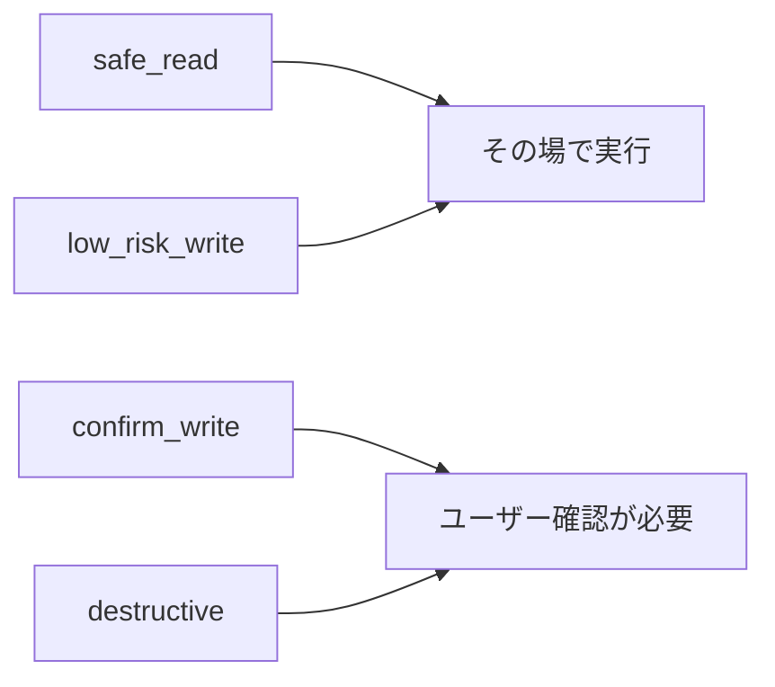

タスク操作では`create_task`、`update_task`、`complete_task`、`set_task_parent`、`retry_task_sync`を可逆な`low_risk_write`として扱います。予定追加、BRAIN本文編集、外部ソースとの紐付けなど影響範囲が広い操作は`confirm_write`を維持し、削除などの`destructive`は常に確認対象です。riskにかかわらず、書き込みToolの引数はschemaで検証してから実行します。

---

## 5. 確認付き書き込みと再開

```mermaid
flowchart TD
    proposal[Agentが確認対象Toolを提案]
    args[Tool schema検証済みの引数]
    saveState[Agent stateをSQLiteへ保存]
    confirmation[Runtimeが確認文とexecute_agent_writeを1回だけ返す]
    register[pending_actions.pyがapproval_idを登録 10分TTL]
    api[POST /api/actions/{approval_id}]
    decision{ユーザーが承認したか}
    cancel[書き込みをキャンセル]
    wrapper[execute_agent_write]
    load{Agent stateが30分以内か}
    expired[期限切れエラー]
    validate{対象Toolが確認対象か}
    invalid[許可されていないTool]
    started[tool_started進捗]
    dispatch[元のsessionを束縛して対象Toolをdispatch / 成功hook]
    failed{書き込み成功か}
    failure[tool_finished失敗]
    resume[resume_after_write]
    readOnly[確認不要Toolだけを公開してAgent Loop再開]
    final[自然な最終回答]
    delete[Agent stateを削除]

    proposal --> args --> saveState --> confirmation --> register --> api --> decision
    decision -->|いいえ| cancel
    decision -->|はい| wrapper --> load
    load -->|いいえ| expired
    load -->|はい| validate
    validate -->|いいえ| invalid
    validate -->|はい| started --> dispatch --> failed
    failed -->|いいえ| failure
    failed -->|はい| resume --> readOnly --> final --> delete
```

`pending_actions.py` が短期のapproval状態、10分TTL、承認API、承認後のTool dispatchを所有します。`chat.py` はAgent Runtimeが返した`pending_actions`を`pending_actions.register(...)`へ渡し、返された`approval_id`を`ChatResponse`へ載せるだけです。APIモデルは`chat_models.py`で共有し、確認Routerから`main.py`を参照しません。

Agentが自然文だけで「実行しますか？」と返した場合は承認として扱わず、確認対象Toolをcallするよう1回だけ再指示します。

---

## 6. 進捗表示

```mermaid
flowchart LR
    runtime[Brain / Agent Runtime]
    events["planning / gathering_context / tool_started / tool_finished / finalizing"]
    emit[agent_progress.emit]
    jobs[(SQLite jobs)]
    api[既存Jobs API]
    visible{Desktop小型画面は表示中?}
    ui[Web / Desktop UIの一時ステータス]
    history[通常会話履歴]

    runtime --> events --> emit --> jobs --> api
    visible -->|表示中・Webは従来どおり| api --> ui
    visible -->|非表示| skip[Desktop取得休止・再表示で即時取得]
    ui -.->|進捗は履歴へ保存しない| history
```

---

## 7. 名前付きタスク完了の決定論的フロー

```mermaid
flowchart TD
    input[/例 LiTデザインは完了した/]
    extract{完了表現と対象名を抽出できるか}
    skip[通常ルートへ]
    cache[(tasks_cache)]
    score[表記を正規化して候補を採点]
    active{未完了候補があるか}
    completed{完了済み候補があるか}
    already[すでに完了と回答]
    none[一致なしと回答]
    unique{最高得点候補が1件か}
    multiple[候補を提示して確認]
    execute[complete_taskを即時実行]
    failed{書き込み成功か}
    success[完了を反映したと回答]
    failure[未反映を明示]

    input --> extract
    extract -->|いいえ| skip
    extract -->|はい| cache --> score --> active
    active -->|いいえ| completed
    completed -->|はい| already
    completed -->|いいえ| none
    active -->|はい| unique
    unique -->|いいえ| multiple
    unique -->|はい| execute --> failed
    failed -->|はい| success
    failed -->|いいえ| failure
```

---

## 8. Project Continuityの決定論的フロー

```mermaid
flowchart TD
    input[/プロジェクトに関する入力/]
    registration{登録の続きか}
    registrationHandle[Project登録フロー]
    completionDraft{完了確認中か}
    completionHandle[Project完了フロー]
    taskCompletion{Task完了の続きか}
    taskHandle[Task完了フロー]
    explicitCompletion{Project完了表現か}
    explicitHandle[Project完了フロー]
    action{明示的な開始 再開 切替か}
    none[通常Brainへ]
    resolve[aliasとactive projectから解決]
    kind{解決結果}
    ambiguous[候補確認]
    candidate[新規Project候補の確認]
    activate[active projectを切替]
    resume[checkpointや外部sourceから復帰文を生成]

    guard[Dialogue State入口でTask確認回答を先に処理]
    workGuard{名前付きTask再開に該当するか}
    workHandle[Task照合と作業セッション再開 または候補確認]
    input --> guard --> workGuard
    workGuard -->|はい| workHandle
    workGuard -->|いいえ| registration
    registration -->|はい| registrationHandle
    registration -->|いいえ| completionDraft
    completionDraft -->|はい| completionHandle
    completionDraft -->|いいえ| taskCompletion
    taskCompletion -->|はい| taskHandle
    taskCompletion -->|いいえ| explicitCompletion
    explicitCompletion -->|はい| explicitHandle
    explicitCompletion -->|いいえ| action
    action -->|いいえ| none
    action -->|はい| resolve --> kind
    kind -->|ambiguous| ambiguous
    kind -->|new_candidate| candidate
    kind -->|resolved| activate --> resume
    kind -->|none| none
```

---

## 9. チャットで行えることの全体像

```mermaid
flowchart TD
    chat([PETIT Chat])
    direct[Tool不要の会話]
    context[タスク 予定 記憶 BRAIN 作業 リマインダー 引き継ぎ]
    tasks[タスクと任意リスト]
    cal[時刻 予定 天気 リマインダー]
    know[BRAIN Notion 記憶検索]
    git[GitHub状況とRepository候補]
    web[ニュースと外部調査]
    mem[長期記憶 要約 復帰 引き継ぎ]
    project[Project Continuity]
    deterministic[決定論的処理]

    chat --> direct
    chat --> context
    chat --> tasks
    chat --> cal
    chat --> know
    chat --> git
    chat --> web
    chat --> mem
    chat --> project
    chat --> deterministic
```

---

## 10. 停止条件と安全境界

```mermaid
flowchart LR
    limits[停止条件と安全境界]
    onePass[Tool不要会話は1回のLLMで終了]
    twoPass[Broker対応Readは原則2回]
    brokerRead[Context BrokerはReadのみ]
    partial[provider片方失敗でも部分結果を維持]
    safeFallback[Router失敗時は読取Toolだけ]
    staticPrefix[system promptへ動的時刻を混ぜない]
    round[Toolラウンド上限]
    calls[Tool総数6回]
    duplicate[同一Tool 同一引数の再実行禁止]
    allowed[Capability外Toolの拒否]
    args[全書き込み引数を実行前に検証]
    defer[作業予告のみの回答を1回再実行]
    confirm[confirm_write destructiveは承認必須]
    explicit[可逆なタスク変更は明示指示時のみ即時実行]
    resume[Agent state 30分TTL]
    approval[approval_id 10分TTL]
    writeOnce[承認後の追加書き込みは禁止]

    limits --> onePass
    limits --> twoPass
    limits --> brokerRead
    limits --> partial
    limits --> safeFallback
    limits --> staticPrefix
    limits --> round
    limits --> calls
    limits --> duplicate
    limits --> allowed
    limits --> args
    limits --> defer
    limits --> confirm
    limits --> explicit
    limits --> resume
    limits --> approval
    limits --> writeOnce
```

---

## 11. 任意のPC観測

```mermaid
flowchart TD
    startup[Module Registryのstartup] --> enabled{設定が有効か}
    enabled -->|いいえ| off[観測しない]
    enabled -->|はい| observer[独立Observer thread]
    observer --> git[指定Gitルートだけを読取 / timeoutあり]
    git --> app[任意で前面アプリ識別子]
    app --> cache[時刻付きsnapshotをメモリに保存]
    cache --> wait[停止可能な間隔待ち]
    wait --> observer
    cache --> api[GET /api/workspace-context]
    cache --> entry[Brain入口 / freshだけ文脈へ]
    shutdown[shutdown] --> stop[停止要求 / snapshotを破棄]
```

この拡張は既定無効で、Web利用の前提ではありません。サーバーPCだけを観測し、通知・外部操作・任意コード実行へ直接接続しません。

## 保守ルール

以下へ変更を加えた場合は、この文書の対応するMermaid図も同じ変更で更新してください。

- `/api/chat`と確認API
- 決定論的な会話ルート
- PETIT Brain / Context Broker / Capabilityグループ
- Agent Tool Loopと停止条件
- Tool Registryとrisk
- 確認付き書き込みとAgent state再開
- ProgressイベントとUI配信
- Project Continuity

Mermaid図と実装が一致しない状態でmainへ反映しないでください。

## 10. Desktop音声入口（Issue #253）

Desktopは既存の会話・承認・TTSを使用する。iPhone PWA / Vocal Shortcutは従来経路を維持する。
詳細と未確認事項は [desktop.md](desktop.md) を参照。

```mermaid
flowchart TD
    Tray[トレイ / グローバルショートカット] --> Main[Electron Main]
    Mic[任意のローカル待機音声] --> Wake[openWakeWord utility process / Python]
    Wake -->|検出のみ・PCMは送信しない| Main
    Main --> Stop[待機マイク停止]
    Stop --> Overlay[小型UI表示]
    Main -->|画面取得失敗 / renderer停止| Recovery[同梱復旧画面・原因を区別]
    Recovery -->|再接続・自動再送なし| Main
    Recovery -->|接続設定| Settings[同梱Desktop設定]
    Overlay -->|作業画面| Workspace[アプリ内Universe・限定IPC・SW登録なし]
    Workspace -->|小型会話| Main
    Workspace -->|Desktop設定| Settings
    Overlay -->|STT設定済み・音声開始| Capture[AudioWorklet録音 / 発話終了判定]
    Capture --> Validate[IPC送信元・WAV・同時実行上限検証]
    Validate --> STT[明示設定されたWhisper互換STT]
    STT -->|確定文字列| Voice[共有 voice.js]
    Overlay -->|文字入力| ChatUI[共有 app.js]
    Voice -->|通常発話| ChatUI
    Voice -->|確認への返事| Approval[既存確認ボタン]
    ChatUI --> ChatAPI[既存 /api/chat / PETIT Brain]
    ChatUI --> Draft[小型会話の下書き・送信中文章を端末保存]
    ChatAPI -->|通信失敗 / 120秒 / 待機中断| Unknown[入力復元・実行結果未確認・自動再送なし]
    Unknown --> Draft
    ChatAPI -->|pending_actions| Approval
    Approval --> ConfirmAPI[既存 /api/actions / Agent state再開]
    ConfirmAPI --> Reply[共有返答UI]
    ChatAPI --> Reply
    Reply --> TTS[共有 /api/tts / 端末TTS]
    Hide[閉じる / ロック / スリープ] --> Cancel[録音・STT取消 / 遅延結果を破棄]
    Cancel --> Resume{非ロック・非スリープ・画面非表示・opt-in?}
    Resume -->|はい| Wake
```


## 11. Web録音入力（Issue #255）

```mermaid
flowchart TD
    Mode[音声入力方式の選択] --> Browser[ブラウザ SpeechRecognition]
    Mode --> Record[MediaRecorder / マイク権限]
    Record --> Stop[停止ボタンまたは60秒 / マイク解放]
    Stop --> API[POST /api/stt / 8MiB上限 / 形式検証]
    API --> STT[設定したWhisper互換STT / 60秒timeout]
    STT --> Text[確定テキスト]
    Browser --> Text
    Text --> Draft{下書きなし・確認待ちの音声回答か}
    Draft -->|はい| Confirm[既存の音声確認処理]
    Draft -->|いいえ| Submit[下書きへ追記 / 既存chat form送信]
    Submit --> Chat[既存 POST /api/chat]
    Record -->|拒否・失敗| Error[原因別案内 / 下書き復元 / 送信しない]
    API -->|未設定・上限超過| Error
    STT -->|通信・応答失敗| Error
    Browser -->|認識失敗| Error
```

## 12. Desktopウェイクモデル自動設定（Issue #256）

```mermaid
flowchart TD
    Button[自動設定ボタン] --> Guard[設定画面IPC検証 / 同時実行防止]
    Guard --> OS[OSと実行アーキテクチャ判定]
    OS --> Key[AccessKeyをsafeStorageで暗号化保存]
    Key --> Permission[マイク権限確認 / Mac初回許可]
    Permission --> Cache{保存済み自動モデルのハッシュと対象が一致?}
    Cache -->|はい| Init[utility processでPorcupine初期化]
    Cache -->|いいえ| PV[固定revisionの日本語pv取得 / SHA-256検証]
    PV --> PPN[Model APIでへいプティ生成 / キーを取得先へ転送しない]
    PPN --> Stage[userDataへ一時配置]
    Stage --> Init
    Init --> Listen[PvRecorder開始 / 30秒の発話案内]
    Listen --> Detected{実際に検出?}
    Detected -->|はい| Save[モデルパス自動保存 / 準備完了]
    Detected -->|時間切れ| Fail[原因表示 / 既存モデル設定維持]
    OS -->|対象外| Fail
    Key -->|安全な保存不可| Fail
    Permission -->|拒否| Fail
    PV -->|通信・形式・ハッシュ異常| Fail
    PPN -->|キー・利用上限・生成失敗| Fail
    Init -->|エラー・時間切れ| Fail
    Cancel[中止 / 設定終了 / 小型画面表示 / ロック・スリープ] --> Fail
    Fail --> Cleanup[テスト停止 / 作成途中ファイル削除]
    Save --> StopTest[テスト停止 / 常時待機の選択は維持]
```

## Desktop Voice Conversation MVP (#286)

```mermaid
flowchart TD
    Wake[openWakeWord / 音声会話ボタン] --> Record[Desktop録音 / 無音で終了]
    Record --> STT[Desktop STT IPC]
    STT --> Chat[共有 app.js / api/chat voiceモード]
    Chat --> Brain[既存 Brain / Broker / 決定論ルート・音声短文方針]
    Brain --> Reply[テキスト即時表示]
    Reply --> TTS[共有 voice.js 分割TTS / 端末音声fallback]
    TTS --> Join{Chat完了と再生完了?}
    Join -->|両方成功| Record
    Chat -->|失敗または確認付きAction| Stop[自動録音停止 / 手動再開]
    Record -->|無音またはマイク失敗| Stop
    TTS -->|再生失敗| Stop
    Hide[非表示 / ロック / 会話終了] --> Stop
```

Desktopのみ連続会話を開始する。Web/PWAは既存の手動入力を維持。
確認付きActionでは自動録音を停止し、既存の承認UI/音声判断境界を維持する。
再生中の音声による割り込み検出は未実装。マイクボタンで再生を停止して入力できる。

`conversation_mode` は `text`（既定）または `voice`。request-local contextで初回Brain・Broker後・Deep Agentのsystem方針へ反映し、本文/履歴や決定論ルート・承認判定を変更しない。実LLMによる1〜3文の遵守は未確認。

会話復元は `voiceSilent` として表示し、自動TTSと現在再生の停止を起こさない。新規返答は従来のTTSへ渡す。

## Dialogue Stateと確認回答 (#294)

```mermaid
flowchart TD
    U[同一sessionの入力] --> Load[SQLite Stateを読取 / 失敗はfallback]
    Load --> Pending{10分以内のtasks所有Pending?}
    Pending -->|候補回答| Select[保存した順序で名前 ID 前者 後者 番号を選択]
    Select --> Claim[Pending IDを原子的に一度だけ消費]
    Claim --> Valid[stable IDで現在のTaskとsourceを再確認]
    Pending -->|cancel| Cancel[Pendingのみ解除]
    Pending -->|明示した別の話題| Clear[Pending解除 / 通常入口へ]
    Pending -->|未解決の短い回答| Ask[Task候補質問を維持 / Work補足は再実行せず通常Brainへ]
    Pending -->|なし| Focus[24時間以内のfocus / 最大8件]
    Focus --> Unique{同一turnで一意か}
    Unique -->|いいえ| Save[操作と候補を保存 / 短く確認]
    Unique -->|はい| Valid
    Valid --> Risk[既存low_risk_write / Task hierarchy検証]
    Risk --> Tool[既存create update complete set_parent start_work_session]
    Tool --> Hook[Registry共通hook / Task成功・Work結果と対象IDを記録]
    Hook --> Reply[結果を返す / 外部同期と部分失敗を区別]
    Tool --> Work[Work開始はSQLite BEGIN IMMEDIATEで同一Taskのactive・pausedを再利用]
    Work --> Verify[返却session IDと保存済みactive Taskを照合]
    Verify -->|一致| Reply
    Verify -->|失敗・不一致| Retry[10分TTLの既存Pendingへ元依頼・対象ID・failed状態を保持]
    Retry -->|明示した再試行だけ| Claim
```

Task clarificationはaction approvalではありません。確認付きwriteは既存確認APIのままです。大量一覧ReadやTask失敗結果はfocusを上書きしません。Work開始失敗は再試行対象としてIDを保持しますが、成功した作業状態とは区別します。Frontend `history`は互換維持し、Dialogueの正本はsession別Backend SQLiteです。明示的な話題転換・キャンセル後は短い開始だけで旧対象を再実行しません。詳細と検証範囲は [Conversation-to-Action Reliability](conversation-action-reliability.md)。

## 接続ステータスと同期診断（#327）

接続確認はユーザーの明示操作でのみ実施する。表示更新では外部API・Chroma・Vault走査・同期workerを呼び出さない。接続成功と同期成功は別々に管理し、再試行は既存の単一タスクAPI、競合は既存のrevision付き比較・採用を共用する。

```mermaid
flowchart TD
    Entry[上部同期表示 / Settings / サイドバー] --> Saved[GET /api/connections]
    Saved --> Local[SQLite同期履歴・診断履歴・Notion outbox/inbox]
    Local --> Redact[公開項目のみ選択・秘密情報を伏せる]
    Redact --> UI[サービス別の接続・同期状態とタスク詳細]
    UI -->|明示的な接続確認| Probe[POST /api/connections/service/check]
    Probe --> Read[対象サービスの読取診断のみ / 同期しない]
    Read --> Cache[SQLiteへ診断結果・成功/エラー時刻を保存]
    Cache --> Saved
    UI -->|失敗タスク1件の再試行| Retry[既存 POST tasks/id/sync/retry]
    Retry --> Queue[既存outboxへ戻す]
    Queue --> Worker[既存workerが処理 / 実試行時刻を記録]
    UI -->|競合を比較| Conflict[既存競合UI・revision確認]
    Conflict --> Choice[PETIT側再同期 / Notion側採用を明示選択]
```


## Renaissance: 確認済みProjectとローカル開発参照（#345 / #341）

```mermaid
flowchart TD
    Task[既存Task.project_id] --> Project[Project Continuity 内部ID]
    Lookup[find_projects / 確認済み別名] --> Project
    Allowed[list_project_workspaces / 明示allowlist] --> Link[link_project_workspace / 利用者確認]
    Project --> Link
    Link --> Verify[承認時にpath・Gitルート・private・symlinkを再検査]
    Verify --> Sources[既存project_source_links / local_workspace / confirmed_at]
    Project --> Read[get_local_development_status project_id]
    Sources --> Read
    Read --> Cache[既存WorkspaceObserver / 正確なrootのworkspace_id]
    Cache --> Facts[観測時刻とstale / 文書mtime・出典 / 実Git状態を区別]
    Facts --> Brain[Brainが必要な情報だけ統合して返答]
```

似た名前での自動紐付けや別の進捗台帳は追加しない。未確認・解除済み・許可撤回・staleは明示する。
詳細: [project-workspaces.md](project-workspaces.md)。
## Renaissance: 元発言検索と長期記憶（#345）

```mermaid
flowchart TD
    Brain[Brainが必要性を判断] -->|原文が必要| Search[search_conversations / bounded query]
    Search --> Scope[Threadのprivacy / source / 時間 / roleを検査]
    Scope --> Original[既存conversationsの入力と出力]
    Original --> Citation[元ID / Thread / 日時 / 発言元 / 原文抜粋]
    Citation --> Brain
    Brain -->|長期知識が必要| Memory[search_memory]
    Memory --> Canonical[SQLite正本で置換・期限・visibilityを検査]
    Canonical --> Results[通常文脈は最大5項目 / 必要なら追加検索]
    Results --> Brain
    Brain -->|記録・訂正| Save[save_memory / 正規化重複を原子的に再利用]
    Save --> History[旧行を削除せずsuperseded_byと有効期限を保存]
    Save -->|standardの新規知識のみ| Index[該当1件だけ索引更新]
```

元発言検索は履歴の暗黙結合ではない。NULL旧sessionは出典不明のまま保持する。
local_onlyの元発言・記憶はstandard会話の検索から除外。local_only検索はembeddingへも送信しない。
詳細: [renaissance-memory.md](renaissance-memory.md)。
