# PETIT Runtime Flows

## ActivityのジョブID検索（v0.56.4）

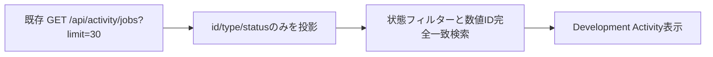

検索は既取得データ内のみで追加API・SQLite操作を行わない。30件より古いIDは検索できないため、見つからなくても存在しないとは断定しない。


## ActivityジョブIDのコピー（v0.52.2・#372）

既存の管理者向け `GET /api/activity/jobs` の読み取り専用表示に、数値ジョブIDだけをコピーする操作を追加。Clipboard APIを使うのは明示クリック時のみで、ジョブの本文・結果・エラー・秘密情報はコピーしない。コピー失敗はボタンに表示し、Job状態やSQLiteは変更しない。

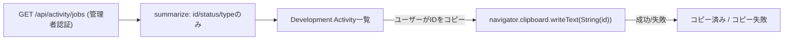


## 会話Turn進捗・応答ドラフトのストリーミング表示（v0.50.0・#410）

体感待ち時間を減らすため、実行中Turnの**表示専用・揮発**の進捗（フェーズ・実行中Tool・返答ドラフト）を `turn_stream` に保持し、`GET /api/turns/{request_id}/stream`（SSE）で配信する。確定結果・承認・effect receipt・保存形式は従来どおり `/api/chat` / `/api/turns/{request_id}` のSQLite台帳を正とする。

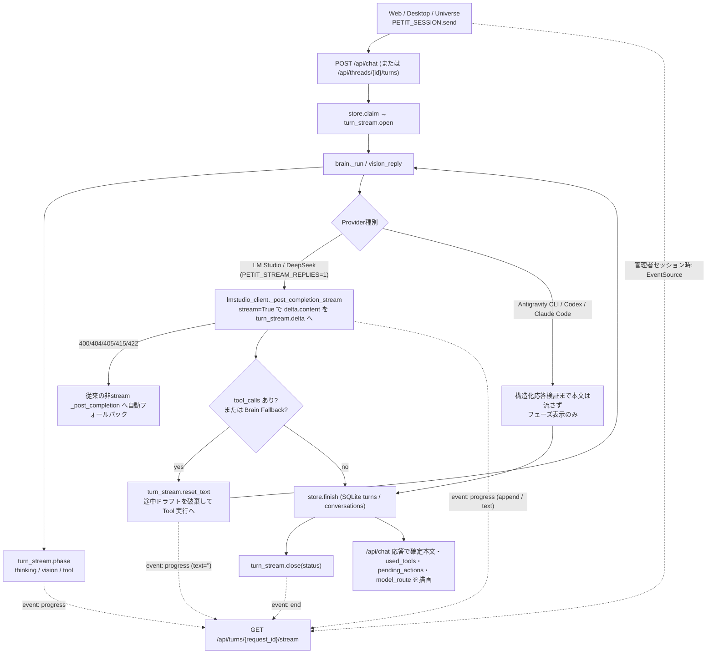

## 開発ジョブ（v0.52.0・#418）

Chat の提案と Develop の直接依頼は同じ SQLite 台帳と Worker を使う。既存の一般作業の CLI 委譲は次節を参照。

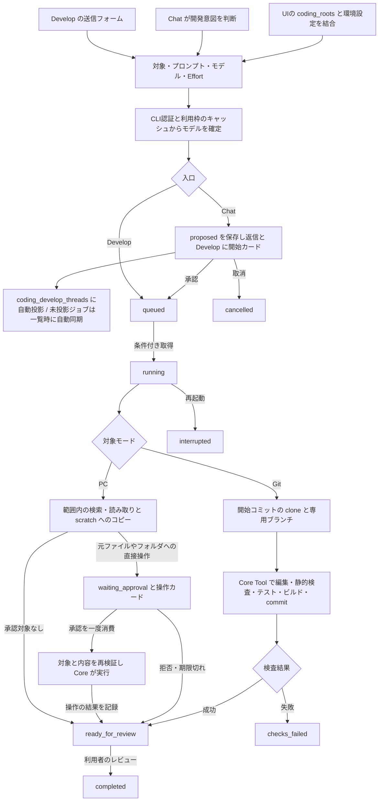

## Front Brain と一般作業の CLI 委譲（#411）

`front_brain_deepseek` が ON のときだけ動く（既定 OFF）。委譲は作業用 Thread の通常の Turn なので、承認・receipt・取消・events は既存のものを使う。実行状態の正本は `turns.status`。詳細は [brain/front-brain-delegation.md](brain/front-brain-delegation.md)。

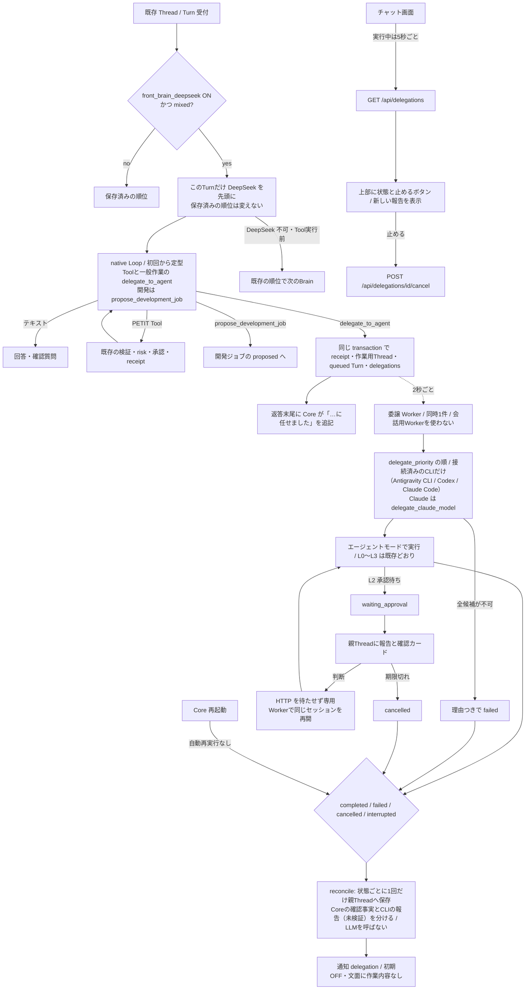

## PETIT Home: 人格の単一ソースと差分承認（v0.46.0開発版）

全Brain（native Tool Loop / Claude Code CLI / Antigravity CLI / Codex）は、同じ PETIT Home の人格ファイルから system 指示を作る。人格ファイルの変更は Core が計算した差分を確認カードに出し、承認後に一度だけ書き込んで git commit する。詳細は [brain/agent-home.md](brain/agent-home.md)。

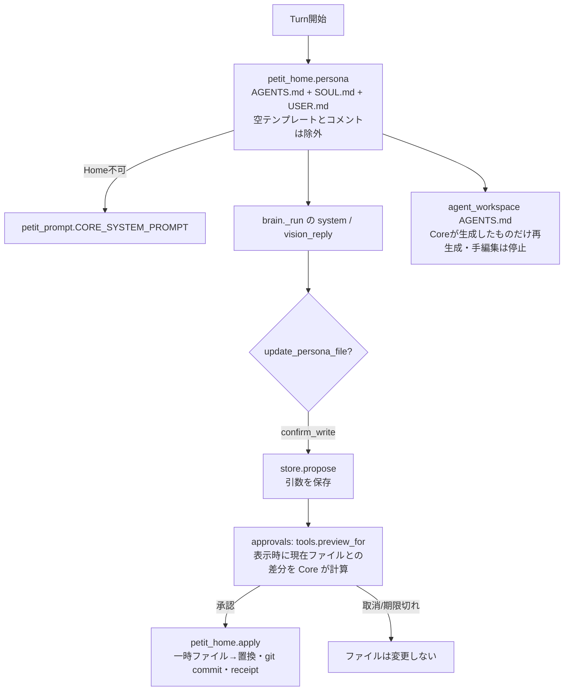

## Discord Owner モード（v0.46.0開発版・#397）

Bot は別プロセスで、Gateway へ外向き接続するだけ。owner 判定は Core が行い、owner 以外には Brain を呼ばない。詳細は [channels/discord-bot.md](channels/discord-bot.md)。

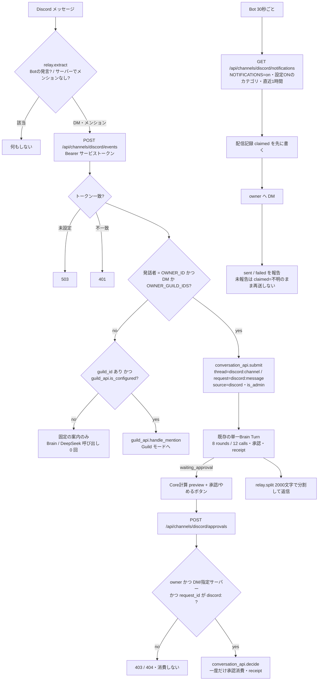

## Discord Guild モード（v0.48.0開発版・#403）

owner 以外、または owner 指定外のサーバーでは、管理者が `/petit setup` を実行したサーバーだけ Guild モードで動く。データは `storage/guilds/<guild_id>.db` に完全分離し、request_context の `guild_mode` によって owner の DB・Tool Registry・PETIT Home・CLI Brain への到達を遮断する。詳細は [channels/discord-bot.md](channels/discord-bot.md) §3・§5.3。

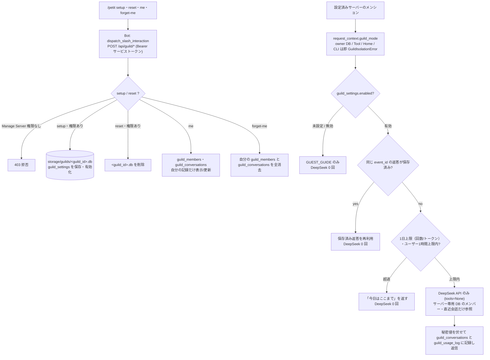

## PETIT MCP bridge（v0.46.0開発版・#398）

CLI に PETIT Tool を MCP（stdio）で渡す土台。呼び出し口が MCP になっても、catalog・検証・risk・承認・receipt は native Loop と同じ。実 Turn への組込みは H3（未実装）。

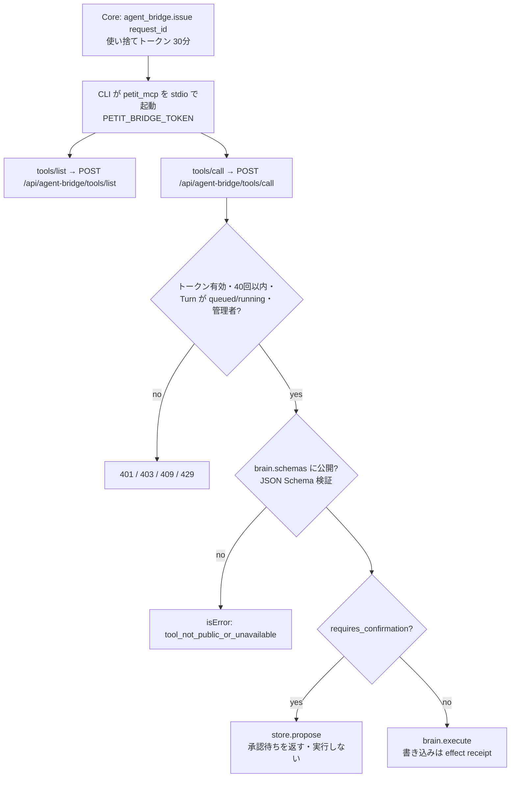

## Home ファイル Tool と Codex エージェントモード（v0.47.0開発版・#404）

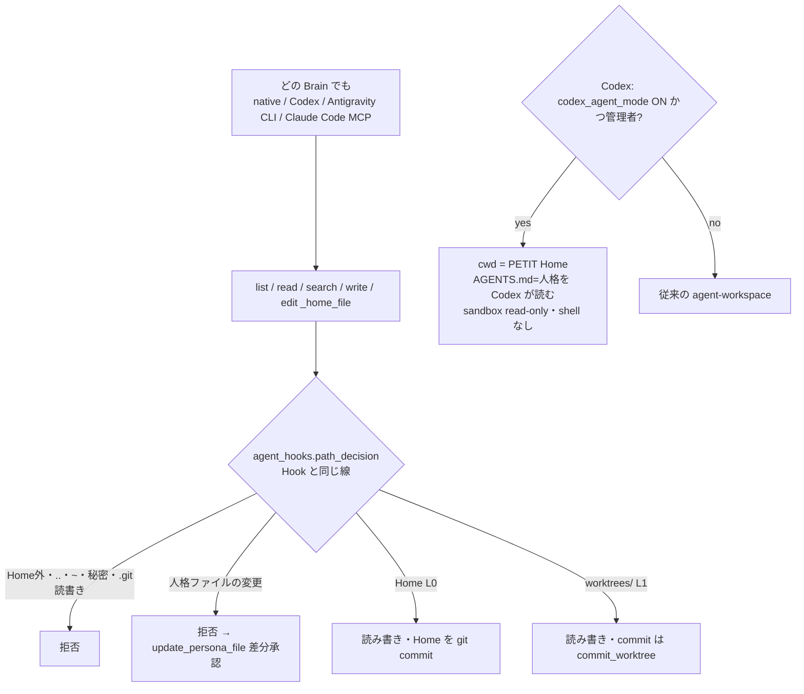

## Worktree の旧経路（v0.46.0開発版・#401）

過去のフロー。v0.52.0 の会話カタログでは新規 Worktree 操作を公開せず、上記の開発ジョブを使う。

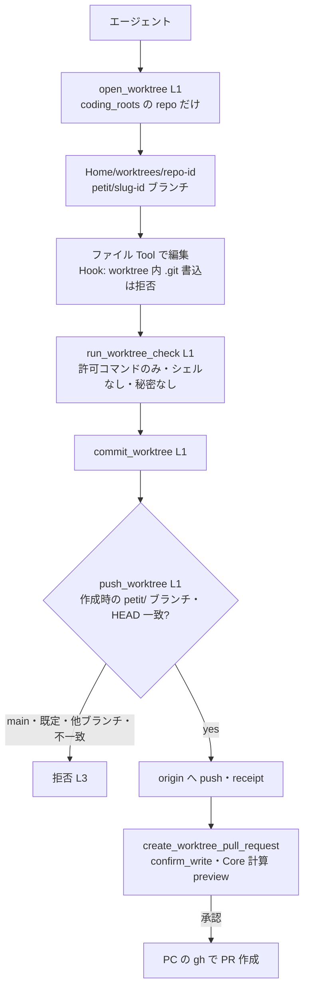

## Claude Code エージェントモード（v0.46.0開発版・#400）

`claude_code_agent_mode` が ON のときだけ、Claude Code の Turn はこの経路になる（OFF なら下の「Claude Code CLI Executor」）。

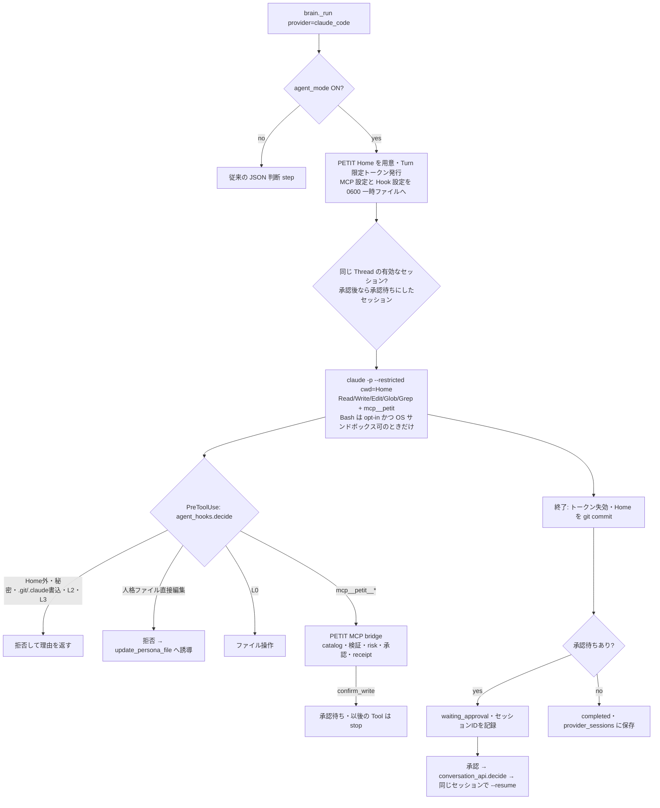

## Development Job UI更新（v0.48.3）

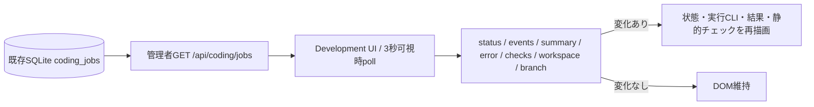

既存の承認・取消・差分表示APIは不変。Claude CodeのProvider名を正しく表示し、実行完了の証拠と静的チェック・実機確認を混同しない。

## Claude Code CLI Executor（v0.44.0開発版）

Concept §4 のExecutor順位（Antigravity CLI ＞ Codex ＞ Claude Code ＞ DeepSeek）の3番目。Antigravity CLIと同じ「構造化した1 round」方式で、Toolの実行・承認・receiptは既存native Loopが行う。

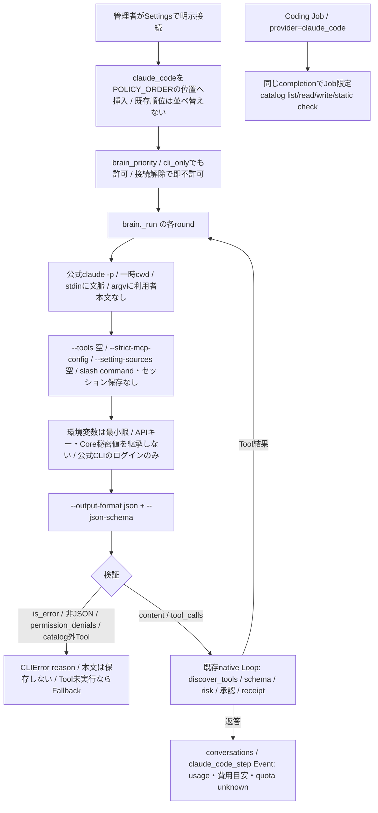

`discover_tools` はCLI Brain（Antigravity CLI / Claude Code）でも応答検証で許可する（v0.44.0で修正。以前はCLI Brainがdiscoveryを要求すると `invalid_cli_response` で失敗していた）。

## #372: Durable Read Task P0 (v0.42.0開発版)

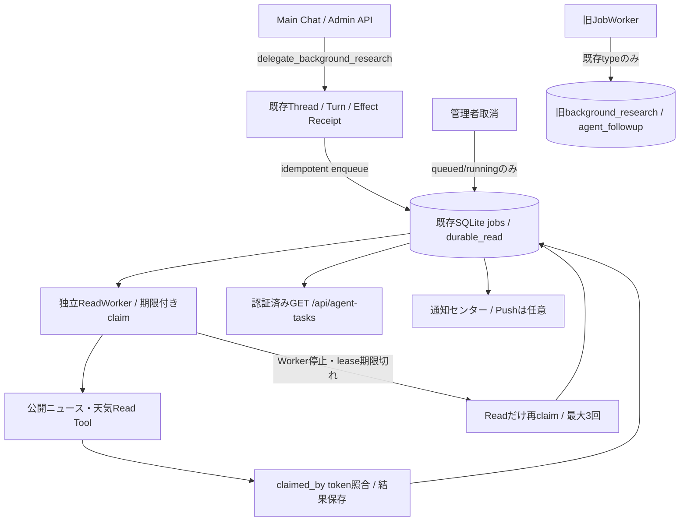

既存通常会話TurnはバックグラウンドJob完了を待たずに新しい入力へ進む。leaseはプロセス生存を保証せず、外部書込みの自動再実行には使わない。公開Readだけがリトライ対象。詳細は [Durable Read Task設計](core/durable-read-tasks.md)。


## #372: Coding Job Activity read-only integration (v0.40.0)

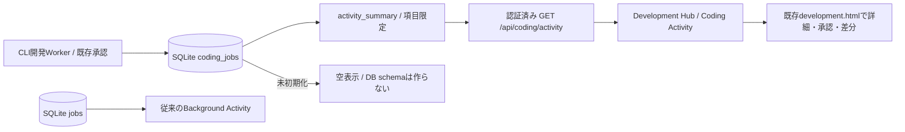

このAPIと画面はread-only。Coding Jobの作成・承認・取消・実行・状態更新の所有者は既存Coding Core。目的文・ローカルパス・生成差分・エラー本文をActivityへ公開しない。runningはDB記録でありプロセス生存を保証しない。未初期化でもbackup/Jobを新規作成しない。

## Antigravity CLI Brainと開発タスク（#362 / #225）

2026-10-29の利用者の明示依頼により、CLI準備段階の一律拒否をSettingsの明示接続へ変更した。環境変数や旧model-routingからは有効化せず、SDK/ACPと別Providerとして表示する。

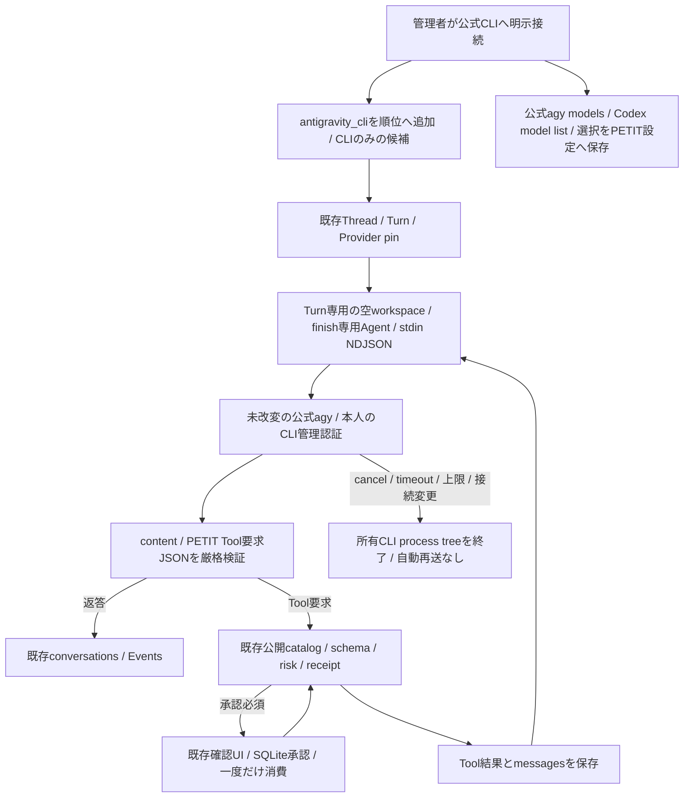

CLIは専用Agentの直接Toolをfinishだけに絞る。Core ToolはJSON要求から既存native Loopで実行し、CLIが独自にShellやファイルを実行する経路を作らない。CLIに会話をargvで渡さず、APIキー・Core秘密値を子へ継承しない。各roundの外部conversation ID/usageは同じSQLite Eventsへ記録する。quotaはunknown。

次の図は旧 Coding Job の入口を示す。新しい依頼は「開発ジョブ（v0.52.0・#418）」を参照。

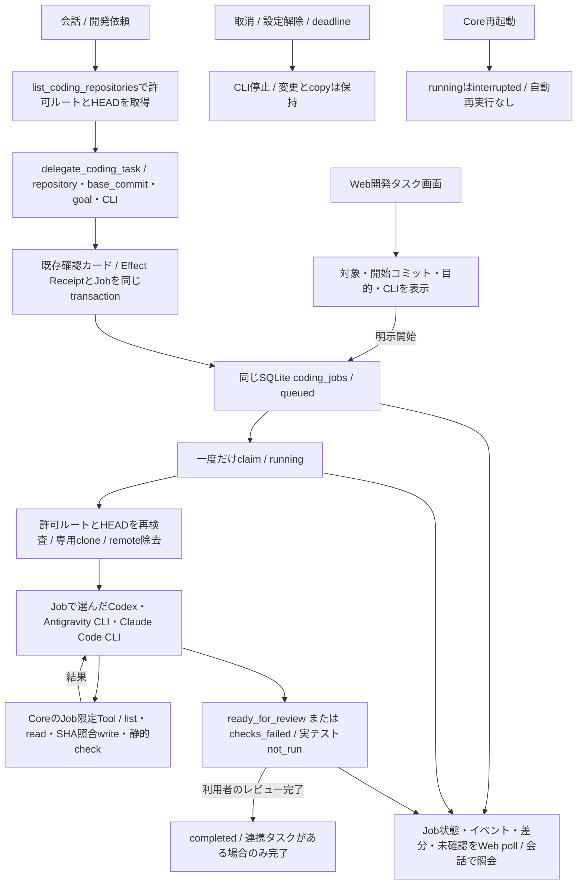

初期実装では任意Shell、任意テストコード実行、削除、Push/PR/mergeを公開しない。Python/JavaScript構文とdiff whitespaceだけを静的検証し、実テスト・実ホスト受入と区別する。[設計・移行境界](dev/coding-tasks.md)を参照。

## #372: Activity / persisted background Job visibility (v0.38.0)

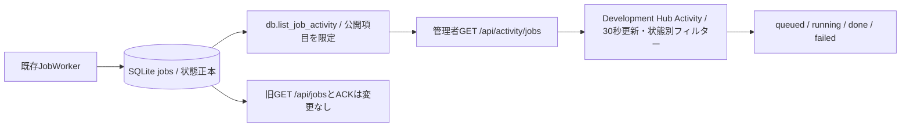

Activityは読むだけ。結果本文・input_json・例外文字列は取得APIへ出さず、通知ACK・ジョブStatus・Worker進行は変更しない。runningはDB記録であり生存確認ではない。lease/restart recovery/新しいdurable Job APIは未実装で後続。

## #372: Development Hub read-only projection (v0.37.0)

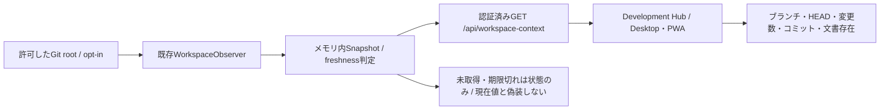

観測は既存Observerが行い、UIアクセスは保存済みsnapshotを読むだけ。Web/PWAからGitコマンド・任意ファイル取得・Worker起動を行うAPIは追加しない。ドキュメントのexcerpt/ファイルパスはDevelopment Hubに投影しない。認可は既存setup middlewareを共有する。#371のCoding Jobsには接続していない。

## #368: Workspace・永続Provider補助Thread・動的Tool公開

```mermaid
flowchart TD
    Accept[既存Core Thread/Turn] --> Provider{Provider固定 / 権限 / privacy}
    Provider -->|Codex| Workspace[専用AGENTS.md / CONTEXT.md / restricted read roots]
    Workspace --> Mapping{同じThread・モデル・権限・公開条件で直前Turnが成功?}
    Mapping -->|はい| Resume[thread/resume / 履歴を二重送信しない]
    Mapping -->|いいえ / rollout欠損| Start[thread/start / Core履歴で復元]
    Resume --> Agent[公式App Server Loop / native Webは明示許可時のみ]
    Start --> Agent
    Provider -->|DeepSeek / LM Studio| Native[既存Native Loop]
    Native --> Compact[初期5 Read + discover_tools / 小さなCapability一覧]
    Agent --> Bridge[petit_read_tool / 小さなCapability一覧]
    Compact --> Discovery{必要schemaの追加発見?}
    Bridge --> Discovery
    Discovery -->|はい| Schemas[その時点の許可済みRegistry schemaを取得 / 操作しない]
    Schemas --> Continue[同じBrainで継続 / 別Routerなし]
    Discovery -->|操作| Validate[実行直前の登録・公開条件・schema・risk・権限を検査]
    Validate --> Effects[既存Approval / Effect Receipt / 保存結果]
    Continue --> Provider
    Effects --> Result[Coreへ結果保存 / 成功時のみ補助session対応保存]
    Result --> Metrics[文字数・利用可能なusage・Call/Tool時間 / 未取得はunknown]
```

SDK旧選択は停止して再選択が必要。guestはToolもNative Webも禁止。local_onlyは外部Readを公開せずCodexへ送信しない。
未設定のGmail/Notion/ローカル開発Toolを除外するが、内部Task/予定/Reminder/Memoryは空データでも利用可能。
Tool Discoveryは最大8名ずつ、完全schemaを返す。内部承認Toolとbackgroundキュー作成は公開しない。
承認待ち・失敗・取消・権限変更では補助Threadを再利用せず、Core保存状態から復元する。
AGENTSは認可境界ではなく、read-only sandbox・機能無効化・Core bridge検証が境界。モデルの個人情報を含む検索語を完全検出するDLPは未実装で、Webは既定OFF。


## v0.34.3: Sona Core / Linkraft撤去（#363）

現行の`get_schedule`は既存Tool Registry、`add_schedule`は現在の承認・実行経路で処理する。Sona専用分岐は削除する。
Project Source RefreshはNotion/GitHub/BRAINを維持し、既存のLinkraft source linkはデータを保持して`skipped`とする。旧図の旧Runtime/承認フローは履歴・比較用であり、現在のRenaissance Core正本は上位のThread/Turn/Receipt図に従う。

```mermaid
flowchart TD
    User[会話 / 既存Thread] --> Brain[Renaissance Brain / 公開Tool]
    Brain --> Registry[現行Tool Registry]
    Registry --> Schedule[get_schedule / 保存済みカレンダー]
    Registry --> Writes[add_schedule / 承認対象]
    Writes --> Approval[Thread/Turn / Approval / Receipt]
    Approval --> Local[ローカル予定DB]
    Resume[プロジェクト再開] --> Sources[確認済みsource link]
    Sources --> Notion[Notion]
    Sources --> Github[GitHub]
    Sources --> Obsidian[BRAIN]
    Sources --> Other[未対応provider / 旧Linkraft]
    Other --> Skipped[skipped / 既存DB行は保持]
```


## v0.34.1: Antigravity CLI準備・本番無効（#355）

CLIのGoogleログイン・既存契約枠はSDK/LM Studioとは別。FAQ/規約とフォーラムの矛盾が
未解決のため、本番Providerに追加していない。`antigravity_cli`の明示指定は拒否し、
他Providerへ暗黙変更しない。Thread/Turn/Approval/Receiptの既存正本を維持する。

```mermaid
flowchart TD
    Settings[管理者Settings] --> Detect[PATH / 公式標準先の存在確認のみ]
    Detect --> Unknown[認証 / モデル / quota / versionはunknown]
    Settings --> Activate[CLI接続 / テスト / 順位変更]
    Activate --> Block[本番拒否: 許諾未確定 / ファイルRead専用も未実証]
    Explicit[CLIを明示した設定 / target] --> Block
    Block --> NoFallback[別Providerへ自動送信しない]
    Offline[隔離テスト: Core受付 / claim] --> Fixture[Mock JSON / NDJSON]
    Fixture --> Parse[ID / schema / 出力上限 / cancel / deadline検査]
    Parse --> Events[既存Threadのmock専用Events: session / text delta / Tool観測]
    Events --> Restore[同じThreadのみID復元 / 同request再実行拒否]
    Parse --> Result[Mock結果: evidence=mock_only / live_verified=false]
    Direct[独立直接診断スクリプト: runtimeから呼ばない] --> Version[agy --version]
    Version --> Live{本人の明示--live}
    Live -->|なし| Stop[診断のみ]
    Live -->|あり| CLI[公式agy / 一時合成README / 明示conversation ID]
    CLI --> Report[直接CLIの観測のみ / 契約枠は照合までunknown]
```

Tool観測は事後情報でありPETIT Toolの再実行や事前承認には使わない。Mockでは
通常のmodel_backend/receiptを生成しない。独立スクリプトの取消/deadlineは所有process
treeを終了するが、実agyでの動作は未検証。詳細: [CLI統合の状態](brain/antigravity-cli.md)。

## Antigravity ACP setup and restricted readiness (#357)

```mermaid
flowchart TD
    UI[管理者が設定画面を開く] --> Install[任意の導入先 / ACP Registry latestから公式配布物取得]
    Install --> Verify[Google CDN配布URL / RegistryのOS・arch・version・SHA-256照合]
    Verify -->|成功| Versioned[PETIT専用versioned install root / agy CLIに非干渉]
    Verify -->|失敗| Fail[導入失敗 / 既存配置を変更しない]
    Versioned --> Handshake[ACP Python SDK / stdio / initialize v1]
    Handshake --> Methods[AgentInfoとauthMethodsのみ表示]
    Methods -->|利用者が明示的にOAuth操作| OAuth[Agentが広告したoauth-personalを選択してauthenticate]
    OAuth --> AgentStore[Google credentialは公式Agentが管理 / PETITは読取・保存しない]
    Methods --> Usage[model・tokens・plan quota・creditsは別状態 / 未取得はunknown]
    AgentStore --> Usage
    Usage --> Disabled[会話Brain・実フォルダ・Terminal・backgroundは無効]
    Disabled --> Gate[Windows OS隔離とACP権限制御の実機検証後に別変更で解禁]
```

initialize handshakeはモデル推論・認証成功・Google契約枠の使用を証明しない。ACP Agentが内部Toolを直接実行するため、PETITのPermission callbackだけではWindows上のファイル書込みやShellを遮断できない。OSレベルの隔離とPETIT既存Approval/Receiptへの正確な接続が完成するまで、会話Providerとしては公開しない。既存 `agy` CLI診断は維持する。Antigravity SDKは#368で撤去済み。

## v0.34.0: 初期設定・優先順位と単一Brain（#353）

管理UIの順位設定がONなら新しい選択経路、OFFなら従来の明示Provider選択を使う。
本文・Thread/Turn・承認・receiptは既存SQLiteが正本。旧キーワードルーティングの図は [archive/runtime-flows-legacy-routing.md](archive/runtime-flows-legacy-routing.md)。

```mermaid
flowchart TD
    C[Web / Desktop / voice] --> Auth[初回は設定UI / 管理者session検査]
    Auth -->|管理者ログイン中| A[全Tool有効のchat adapter / Turn API]
    Auth -->|非管理者・通常モード| Safe[通常会話モード: Tool全般禁止・テキスト応答のみ]
    A --> L[request ID / 入力hash / Threadを原子的に受付]
    Safe --> L
    L -->|同一入力の再送| R[保存済み結果 / 承認 / receipt]
    L -->|ID衝突 / 同じThread実行中| Conflict[409 / 429]
    L --> Select[順位または従来選択 / local_only / 接続と費用同意を検査]
    Select --> Transport{Brain接続方式}
    Transport -->|mixed| Pin[選択Event / Provider pin / 同じThreadの履歴と運用アラート]
    Transport -->|cli_only| CLIOnly[Codex・明示接続したAntigravity CLI / Claude Code CLI / SDK・APIを除外]
    CLIOnly --> Pin
    Pin --> Backend{単一Runtimeの所有者}
    Backend -->|DeepSeek / LM Studio| Native[既存native Tool Loop]
    Backend -->|Codex| Codex[app-server Agent Loop]
    Backend -->|Antigravity CLI| AgCli[公式agy CLI Agent Loop]
    Backend -->|Claude Code CLI| CcCli[公式claude CLI 構造化round]
    Backend -->|旧SDK選択| Migrate[停止して再選択案内]
    Native --> Gate[Registry / 公開catalog / schema / risk / cancel]
    Codex -->|dynamic PETIT Tool| Gate
    AgCli -->|dynamic Tool| Gate
    CcCli -->|JSON Tool要求| Gate
    Gate -->|確認必須| Approval[SQLite承認とmessages / Runtime終了]
    Approval --> UI[既存確認UI / 再起動復元]
    UI -->|一度だけ承認消費| Execute[既存Domain Tool]
    Gate -->|Read / 低リスクWrite| Execute
    Execute -->|SQLite Write| Receipt[Domain保存とreceiptを同じtransaction]
    Execute -->|外部Write| Unknown[receipt / 不明はunknown / 自動再実行なし]
    Execute --> Return[同じRuntimeへTool結果 / call IDを保存]
    Receipt --> Return
    Unknown --> Return
    Return --> Backend
    Backend -->|Tool開始前の障害のみ| Stop[現在のRuntimeを完全終了]
    Stop --> Next{接続方式で許可された接続済み次候補}
    Next -->|あり| Pin
    Next -->|なし| Failed[失敗状態 / 次Turnは順位の上位から再試行]
    Backend -->|Tool後の障害| Failed
    Backend -->|正常回答| Save[未解決同期警告を一言付加 / conversations本文とEvents保存]
    Save --> R
```

SDKは撤去済み。Codexのshell/apps/plugins/subagentは無効、許可していないserver requestは拒否する。各Runtimeを終了してからFallbackし、Tool実行後はLoopを再開しない。
`brain_transport=cli_only`はCodexと明示接続したAntigravity CLI / Claude Code CLIを許可し、障害時もSDK/APIへFallbackしない。既存設定は`mixed`のまま引き継ぐ。
CLIの導入検出は受動的に行い、明示した診断で`account/read`を確認する。認証確認と実推論の接続テストは別。
画像は既存Vision観測→Read専用回答で、画像Providerの順位Fallbackは未対応。
8 rounds / 12 callsと取消/deadlineを維持し、local_onlyは外部へ送らない。

```mermaid
flowchart TD
    Wizard[初回ウィザード / 統合Settings] --> Admin[scrypt管理者 / HttpOnly cookie / Origin検査]
    Admin --> Host[ホスト別の暗号化設定 / Git管理外 / atomic更新]
    Admin --> OAuth[Google共通OAuth / session + state + PKCE / scope追加同意]
    OAuth --> Google[Calendar read-only / Gmail read-only]
    Host --> Connect[Notion対象選択 / TimeTree既存exporter / AI接続]
    Host --> Calendar[外部Calendarは1つ / 未接続はlocal]
    Calendar --> Due[SQLite日次枠とlease / 02:00 JST / 起動時catch-up / 手動再試行]
    Due --> Fetch[Google全ページdelta / 410時full / TimeTree全snapshot]
    Fetch -->|成功| Commit[差分とcursorを同じtransaction / 正常cache保持]
    Fetch -->|失敗| Alert[永続アラートを先に保存 / 前回cacheとcursor保持]
    Connect --> Notion[既存Notion日次同期の結果監視]
    Notion -->|失敗| Alert
    Alert --> Notify[重複抑制 / 高優先度Push + アプリ内 / 失敗でも記録保持]
    Alert --> Context[復旧まで各会話に概要 / 末尾に一言]
    Commit --> Resolve[アラート解除 / 最終成功と更新件数]
    Notion -->|正常同期| Resolve
    Google --> Mail[既存Tool RegistryへGmail検索・本文Read]
```

外部Calendarへの自動書き戻しはなく、Google双方向は未実装。詳細・認証前提・未確認事項は
[初期設定と接続](ops/setup-integrations.md)。既存SDK実証は[SDK導入記録](brain/antigravity-brain-poc.md)、
Coreの所有権・DB互換は[renaissance-core.md](core/renaissance-core.md)。


Thread/Turn/Eventsの現行経路は上図を参照する。[Desktop・共通Core基盤設計](desktop/desktop-foundation-design.md)（#301）全体の端末・管理機能の完成を示すものではない。

[AI-First設計と比較PoC](core/ai-first-agent-design.md)（#338）の実験を経て、通常text経路を上図へ移行した。旧キーワードルーティングの図はv0.45.0の撤去に合わせて [archive/runtime-flows-legacy-routing.md](archive/runtime-flows-legacy-routing.md) へ移した。

## ローカル開発観測（#341 / #418）

```mermaid
flowchart TD
    settings[UIの登録フォルダと環境設定を結合] --> observer[WorkspaceObserverの定期refresh]
    observer --> root{指定ディレクトリがGitルート?}
    root -->|NO| folder[登録フォルダの状態のみ]
    root -->|YES| git[git status / local HEAD・branches・log・tracking差分]
    root -->|YES| docs[Concept / PROGRESS / README の固定3ファイルを上限付きで読む]
    folder --> cache
    git --> cache[スナップショットメモリ cache: collected_at / stale]
    docs --> cache
    cache --> api[GET api/workspace-context]
    cache --> tool[Agent get_local_development_status safe_read]
    cache -->|会話コンテキスト注入を有効化した場合| Context[会話へ限定情報を渡す]
    tool --> response[文書上の目標・作業状態・未検証を区別して答える]
```

設計詳細と安全境界は [local-development-insight.md](dev/local-development-insight.md)。ローカル参照はfetch/pullしない。文書内の指示を実行しない。GitHub最新・実機テスト済み・プロジェクト完了は別の証拠が必要。Toolは既存観測キャッシュを参照するだけで再走査しない。

## 作業統計タブ（v0.28.0 / #319・#321）

```mermaid
flowchart TD
    tab[統計タブを開く / 表示中30秒 / 手動更新] --> read[今日と直近7日の既存APIを並列取得]
    read --> today[/api/work-sessions/today]
    read --> week[/api/work-sessions/summary?days=7]
    select[日付入力 / 日別の棒] --> day[/api/work-sessions/days/DATE]
    day --> core
    day --> note[日付別の振り返りとrevisionを取得]
    today --> note
    note --> edit[入力と未保存の下書きを保持]
    edit --> save[明示保存 PUT days/DATE/reflection]
    save --> check{SQLiteトランザクションでrevision一致?}
    check -->|一致| stored[メモ保存 / revision更新]
    check -->|不一致| conflict[409 / 入力保持 / 保存済みの再読込を案内]
    today --> core[Coreで休憩とJSTの日境界を集計]
    week --> core
    core --> display[今日の合計・件数・最長 / 日別とタスク別グラフ / 記録]
    read -->|一部失敗| partial[成功分を表示 / 残す値は前回と明記]
    read -->|15秒経過| timeout[取得中断 / 更新で再試行]
    leave[タブ切替・非表示] --> cancel[未完了の取得中断 / 非表示の定期取得停止]
```

表示は `frontend/today.js` / `frontend/statistics.css`、集計は既存 `backend/work_sessions.py`。既存の集計を共用し、日別取得API・振り返りの明示保存APIと専用SQLite表を追加する。今日の既存APIにも振り返りを付加し、作業記録は変更しない。[画面と検証範囲](life/work-statistics.md)を参照。

## Desktopの画面準備と復旧（v0.28.0 / #321）

```mermaid
flowchart TD
    navigation[main-frameの移動] --> document{同じ文書内の履歴・タブ切替?}
    document -->|はい| keepReady[preloadのready状態を維持]
    document -->|いいえ| resetReady[readyを解除 / 古い待機タイマーを停止]
    resetReady --> loaded[did-finish-load / 8秒の準備待ち]
    loaded --> ready{preloadからreadyを受信?}
    ready -->|はい| usable[作業画面を継続]
    ready -->|いいえ| recover[同梱復旧画面]
    crash[renderer停止 / main-frame読込失敗] --> recover
```

## Desktop v0.26.0の入力・同期競合・通知

```mermaid
flowchart TD
    input[共通チャット入力] --> ime{IME確定・Enter長押し・送信待機中?}
    ime -->|いいえ| chat[既存chat submit / API]
    ime -->|はい| keep[入力を保持 / 再送しない]
    conflict[PETIT内の同期競合ボタン] --> compare[DB・更新キュー・Notion最新を比較]
    compare --> choice[利用者がPETIT側 / Notion側を選択]
    choice --> revision{比較revision一致?}
    revision -->|いいえ| retry[409 / 最新差分を再確認]
    revision -->|PETIT側| queue[未同期payloadを最新revisionでpendingへ / 監査]
    queue --> latest{実行直前のNotion更新日時一致?}
    latest -->|いいえ| again[競合を保持して再比較]
    latest -->|はい| patch[既存Notion更新 / 成功時だけsynced]
    revision -->|Notion側| adopt[同一トランザクションでキュー取り下げ・DBと親関係へ採用・snapshot保存・監査]
    adopt -->|途中失敗| rollback[全体をrollback / 競合とローカル変更を保持]
    compare -->|404・接続失敗| blocked[共有・親ページの確認案内 / 競合保持]
    event[CoreのReminder / Work Session等の通知イベント] --> history[SQLite通知センター]
    history --> web[既存Web Push / VAPID・購読が必要]
    history --> poll[Desktop Mainが15秒ごとにafter_id取得]
    poll --> eligible{端末ON・カテゴリON・新規・未読・未解決・2分以内・ロック外?}
    eligible -->|はい| desktop[画面のすみのカード / OS通知]
    eligible -->|いいえ| quiet[表示せず履歴へ残す]
    desktop --> cursor[端末へorigin別cursor保存 / 重複抑制]
    quiet --> cursor
```

新しいThread/Turn/Core管理APIは追加していない。詳細と実機未確認は [desktop-v26-experience.md](archive/desktop-v26-experience.md)。

## 11. 任意のPC観測

```mermaid
flowchart TD
    startup[Module Registryのstartup] --> enabled{設定が有効か}
    enabled -->|いいえ| off[観測しない]
    enabled -->|はい| observer[独立Observer thread]
    observer --> git[指定Gitルートだけを読取 / timeoutあり]
    git --> app[任意で前面アプリ識別子]
    app --> cache[時刻付きsnapshotをメモリに保存]
    cache --> wait[停止可能な間隔待ち]
    wait --> observer
    cache --> api[GET /api/workspace-context]
    cache --> entry[Brain入口 / freshだけ文脈へ]
    shutdown[shutdown] --> stop[停止要求 / snapshotを破棄]
```

この拡張は既定無効で、Web利用の前提ではありません。サーバーPCだけを観測し、通知・外部操作・任意コード実行へ直接接続しません。

## 保守ルール

以下へ変更を加えた場合は、この文書の対応するMermaid図も同じ変更で更新してください。

- `/api/chat`・Thread/Turn API と確認API
- Brain選択（優先順位・`cli_only`・Fallback）と各Brain（native Loop / Codex / Antigravity CLI / Claude Code CLI）
- 公開Tool catalog・`discover_tools`・Tool Registryとrisk
- 確認付き書き込み・承認の消費・effect receipt
- 停止条件（8 rounds / 12 calls・取消・deadline）
- 画像付き会話のRead専用経路（`vision_reply.py`）
- Coding Job と Durable Read Task

Mermaid図と実装が一致しない状態でmainへ反映しないでください。旧キーワードルーティングの図は [archive/runtime-flows-legacy-routing.md](archive/runtime-flows-legacy-routing.md)。

## 画像付き会話のRead専用経路（v0.31.0 / v0.45.0で移設）

```mermaid
flowchart TD
    Upload[画像添付 / opaque ID・形式・容量検査] --> Gate{cli_only?}
    Gate -->|はい| Reject[画像付きは未対応と返す / API送信しない]
    Gate -->|いいえ| Observe[vision.analyze / 観測JSON]
    Observe --> Egress{外部Provider かつ 画像送信の明示許可なし?}
    Egress -->|はい| Off[送信OFFを返す]
    Egress -->|いいえ| Reply[vision_reply.run_with_images / tools=None の1 Call]
    Reply --> Save[conversationsへ保存 / 観測は24h TTL]
    Reply -.->|Tool要求・空応答| Fail[回答生成失敗として返す]
```

画像の内容は操作・承認・Toolへ渡さない。操作は画像なしの明示依頼として通常のBrainで扱う。

## 10. Desktop音声入口（Issue #253）

Desktopは既存の会話・承認・TTSを使用する。iPhone PWA / Vocal Shortcutは従来経路を維持する。
詳細と未確認事項は [desktop.md](desktop/desktop.md) を参照。

```mermaid
flowchart TD
    Tray[トレイ / グローバルショートカット] --> Main[Electron Main]
    Mic[任意のローカル待機音声] --> Wake[openWakeWord utility process / Python]
    Wake -->|検出のみ・PCMは送信しない| Main
    Main --> Stop[待機マイク停止]
    Stop --> Overlay[小型UI表示]
    Main -->|画面取得失敗 / renderer停止| Recovery[同梱復旧画面・原因を区別]
    Recovery -->|再接続・自動再送なし| Main
    Recovery -->|接続設定| Settings[同梱Desktop設定]
    Overlay -->|作業画面| Workspace[アプリ内Universe・限定IPC・SW登録なし]
    Workspace -->|小型会話| Main
    Workspace -->|Desktop設定| Settings
    Overlay -->|STT設定済み・音声開始| Capture[AudioWorklet録音 / 発話終了判定]
    Capture --> Validate[IPC送信元・WAV・同時実行上限検証]
    Validate --> STT[明示設定されたWhisper互換STT]
    STT -->|確定文字列| Voice[共有 voice.js]
    Overlay -->|文字入力| ChatUI[共有 app.js]
    Voice -->|通常発話| ChatUI
    Voice -->|確認への返事| Approval[既存確認ボタン]
    ChatUI --> ChatAPI[既存 /api/chat / PETIT Brain]
    ChatUI --> Draft[小型会話の下書き・送信中文章を端末保存]
    ChatAPI -->|通信失敗 / 120秒 / 待機中断| Unknown[入力復元・実行結果未確認・自動再送なし]
    Unknown --> Draft
    ChatAPI -->|pending_actions| Approval
    Approval --> ConfirmAPI[既存 /api/actions / Agent state再開]
    ConfirmAPI --> Reply[共有返答UI]
    ChatAPI --> Reply
    Reply --> TTS[共有 /api/tts / 端末TTS]
    Hide[閉じる / ロック / スリープ] --> Cancel[録音・STT取消 / 遅延結果を破棄]
    Cancel --> Resume{非ロック・非スリープ・画面非表示・opt-in?}
    Resume -->|はい| Wake
```


## 11. Web録音入力（Issue #255）

```mermaid
flowchart TD
    Mode[音声入力方式の選択] --> Browser[ブラウザ SpeechRecognition]
    Mode --> Record[MediaRecorder / マイク権限]
    Record --> Stop[停止ボタンまたは60秒 / マイク解放]
    Stop --> API[POST /api/stt / 8MiB上限 / 形式検証]
    API --> STT[設定したWhisper互換STT / 60秒timeout]
    STT --> Text[確定テキスト]
    Browser --> Text
    Text --> Draft{下書きなし・確認待ちの音声回答か}
    Draft -->|はい| Confirm[既存の音声確認処理]
    Draft -->|いいえ| Submit[下書きへ追記 / 既存chat form送信]
    Submit --> Chat[既存 POST /api/chat]
    Record -->|拒否・失敗| Error[原因別案内 / 下書き復元 / 送信しない]
    API -->|未設定・上限超過| Error
    STT -->|通信・応答失敗| Error
    Browser -->|認識失敗| Error
```

## 12. Desktopウェイクモデル自動設定（Issue #256）

```mermaid
flowchart TD
    Button[自動設定ボタン] --> Guard[設定画面IPC検証 / 同時実行防止]
    Guard --> OS[OSと実行アーキテクチャ判定]
    OS --> Key[AccessKeyをsafeStorageで暗号化保存]
    Key --> Permission[マイク権限確認 / Mac初回許可]
    Permission --> Cache{保存済み自動モデルのハッシュと対象が一致?}
    Cache -->|はい| Init[utility processでPorcupine初期化]
    Cache -->|いいえ| PV[固定revisionの日本語pv取得 / SHA-256検証]
    PV --> PPN[Model APIでへいプティ生成 / キーを取得先へ転送しない]
    PPN --> Stage[userDataへ一時配置]
    Stage --> Init
    Init --> Listen[PvRecorder開始 / 30秒の発話案内]
    Listen --> Detected{実際に検出?}
    Detected -->|はい| Save[モデルパス自動保存 / 準備完了]
    Detected -->|時間切れ| Fail[原因表示 / 既存モデル設定維持]
    OS -->|対象外| Fail
    Key -->|安全な保存不可| Fail
    Permission -->|拒否| Fail
    PV -->|通信・形式・ハッシュ異常| Fail
    PPN -->|キー・利用上限・生成失敗| Fail
    Init -->|エラー・時間切れ| Fail
    Cancel[中止 / 設定終了 / 小型画面表示 / ロック・スリープ] --> Fail
    Fail --> Cleanup[テスト停止 / 作成途中ファイル削除]
    Save --> StopTest[テスト停止 / 常時待機の選択は維持]
```

## Desktop Voice Conversation MVP (#286)

```mermaid
flowchart TD
    Wake[openWakeWord / 音声会話ボタン] --> Record[Desktop録音 / 無音で終了]
    Record --> STT[Desktop STT IPC]
    STT --> Chat[共有 app.js / api/chat voiceモード]
    Chat --> Brain[既存 Brain / Broker / 決定論ルート・音声短文方針]
    Brain --> Reply[テキスト即時表示]
    Reply --> TTS[共有 voice.js 分割TTS / 端末音声fallback]
    TTS --> Join{Chat完了と再生完了?}
    Join -->|両方成功| Record
    Chat -->|失敗または確認付きAction| Stop[自動録音停止 / 手動再開]
    Record -->|無音またはマイク失敗| Stop
    TTS -->|再生失敗| Stop
    Hide[非表示 / ロック / 会話終了] --> Stop
```

Desktopのみ連続会話を開始する。Web/PWAは既存の手動入力を維持。
確認付きActionでは自動録音を停止し、既存の承認UI/音声判断境界を維持する。
再生中の音声による割り込み検出は未実装。マイクボタンで再生を停止して入力できる。

`conversation_mode` は `text`（既定）または `voice`。request-local contextで初回Brain・Broker後・Deep Agentのsystem方針へ反映し、本文/履歴や決定論ルート・承認判定を変更しない。実LLMによる1〜3文の遵守は未確認。

会話復元は `voiceSilent` として表示し、自動TTSと現在再生の停止を起こさない。新規返答は従来のTTSへ渡す。

## 接続ステータスと同期診断（#327）

接続確認はユーザーの明示操作でのみ実施する。表示更新では外部API・Chroma・Vault走査・同期workerを呼び出さない。接続成功と同期成功は別々に管理し、再試行は既存の単一タスクAPI、競合は既存のrevision付き比較・採用を共用する。

```mermaid
flowchart TD
    Entry[上部同期表示 / Settings / サイドバー] --> Saved[GET /api/connections]
    Saved --> Local[SQLite同期履歴・診断履歴・Notion outbox/inbox]
    Local --> Redact[公開項目のみ選択・秘密情報を伏せる]
    Redact --> UI[サービス別の接続・同期状態とタスク詳細]
    UI -->|明示的な接続確認| Probe[POST /api/connections/service/check]
    Probe --> Read[対象サービスの読取診断のみ / 同期しない]
    Read --> Cache[SQLiteへ診断結果・成功/エラー時刻を保存]
    Cache --> Saved
    UI -->|失敗タスク1件の再試行| Retry[既存 POST tasks/id/sync/retry]
    Retry --> Queue[既存outboxへ戻す]
    Queue --> Worker[既存workerが処理 / 実試行時刻を記録]
    UI -->|競合を比較| Conflict[既存競合UI・revision確認]
    Conflict --> Choice[PETIT側再同期 / Notion側採用を明示選択]
```


## Renaissance: 確認済みProjectとローカル開発参照（#345 / #341）

```mermaid
flowchart TD
    Task[既存Task.project_id] --> Project[Project Continuity 内部ID]
    Lookup[find_projects / 確認済み別名] --> Project
    Allowed[list_project_workspaces / 明示allowlist] --> Link[link_project_workspace / 利用者確認]
    Project --> Link
    Link --> Verify[承認時にpath・Gitルート・private・symlinkを再検査]
    Verify --> Sources[既存project_source_links / local_workspace / confirmed_at]
    Project --> Read[get_local_development_status project_id]
    Sources --> Read
    Read --> Cache[既存WorkspaceObserver / 正確なrootのworkspace_id]
    Cache --> Facts[観測時刻とstale / 文書mtime・出典 / 実Git状態を区別]
    Facts --> Brain[Brainが必要な情報だけ統合して返答]
```

似た名前での自動紐付けや別の進捗台帳は追加しない。未確認・解除済み・許可撤回・staleは明示する。
詳細: [project-workspaces.md](dev/project-workspaces.md)。
## Renaissance: 元発言検索と長期記憶（#345）

```mermaid
flowchart TD
    Brain[Brainが必要性を判断] -->|原文が必要| Search[search_conversations / bounded query]
    Search --> Scope[Threadのprivacy / source / 時間 / roleを検査]
    Scope --> Original[既存conversationsの入力と出力]
    Original --> Citation[元ID / Thread / 日時 / 発言元 / 原文抜粋]
    Citation --> Brain
    Brain -->|長期知識が必要| Memory[search_memory]
    Memory --> Canonical[SQLite正本で置換・期限・visibilityを検査]
    Canonical --> Results[通常文脈は最大5項目 / 必要なら追加検索]
    Results --> Brain
    Brain -->|記録・訂正| Save[save_memory / 正規化重複を原子的に再利用]
    Save --> History[旧行を削除せずsuperseded_byと有効期限を保存]
    Save -->|standardの新規知識のみ| Index[該当1件だけ索引更新]
```

元発言検索は履歴の暗黙結合ではない。NULL旧sessionは出典不明のまま保持する。
local_onlyの元発言・記憶はstandard会話の検索から除外。local_only検索はembeddingへも送信しない。
詳細: [renaissance-memory.md](core/renaissance-memory.md)。

## Development Activity 可視時更新（#372 / v0.43.0）

```mermaid
flowchart TD
    Visible[Development Hub表示かつページ可視] --> Timer[30秒ごとの更新]
    Timer --> API[認証済みGET /api/activity/jobs]
    API --> SQLite[既存jobs SQLite正本]
    SQLite --> UI[保存済み状態のみ表示 / Worker生存は未保証]
    Hidden[他画面・非表示] --> Pause[ポーリングを行わない]
    Coding[Codex Coding Jobs] --> Separate[既存別一覧 /api/coding/activity]
```

背景Readの状態表示は既存APIの投影を利用し、入力・結果本文を取得しない。手動更新も維持する。


## Activity取得の鮮度表示（v0.48.1）

```mermaid
flowchart TD
  UI[Development Hub Activity] --> GET[GET /api/activity/jobs]
  GET -->|成功| Saved[一覧更新・最終取得日時を保存]
  GET -->|失敗| Stale[前回一覧を保持・取得失敗と最終成功日時を表示]
  Saved --> SQLite[(既存SQLite jobsの読み取り投影)]
```

この表示はブラウザでの最終取得時刻であり、Workerの生存確認ではない。Brainや永続ジョブの実行契約は変更しない。

## Discord Archive & Knowledge Gateway（Nocord統合）

Discord上の会話・添付ファイル（PDF/テキスト等）をバックグラウンドで収集・FTS5索引化し、全入口のBrainから出典つきで検索可能にする。通常会話を一切遅延させず、Guild/Ownerのセキュリティ境界を厳格に維持する。

```mermaid
flowchart TD
    DiscordMsg[Discord メッセージ / 編集 / 削除] --> Bot[Discord Bot プロセス]
    Bot --> IngestTask["バックグラウンド非同期タスク<br/>(通常会話への遅延ゼロ)"]
    IngestTask --> API["POST /api/channels/discord/archive/events<br/>(Bearer サービストークン認証)"]
    API --> Consent{Allowlist に登録済み?<br/>かつ ゾーン一致?}
    Consent -->|No| Discard[安全に無視 / 保存しない]
    Consent -->|Yes| Store[(SQLite storage/archive/zone.sqlite<br/>WAL / tombstone / revision)]
    Store --> FTS["FTS5 + Trigram + 添付テキスト抽出<br/>(PDF / txt / md / json)"]

    Brain[Brain: 自然言語での質問] --> NeedSearch{過去ログの検索が必要?}
    NeedSearch -->|Yes| ToolCall["Tool: search_discord_archive"]
    ToolCall --> ContextCheck{Guild モード?}
    ContextCheck -->|Yes| GuildIsolate["GuildIsolationError<br/>または 自サーバーのみに強制制限"]
    ContextCheck -->|No| SearchRun["FTS5 + Trigram + BM25 ハイブリッド検索<br/>(Personal Zone / 権限スコープ強制)"]
    SearchRun --> Provenance["出典情報生成<br/>(URL / 発言者 / チャンネル / 日時 / 添付抜粋)"]
    Provenance --> Brain
    Brain --> Answer["根拠つきの回答をユーザーへ提示"]
```
